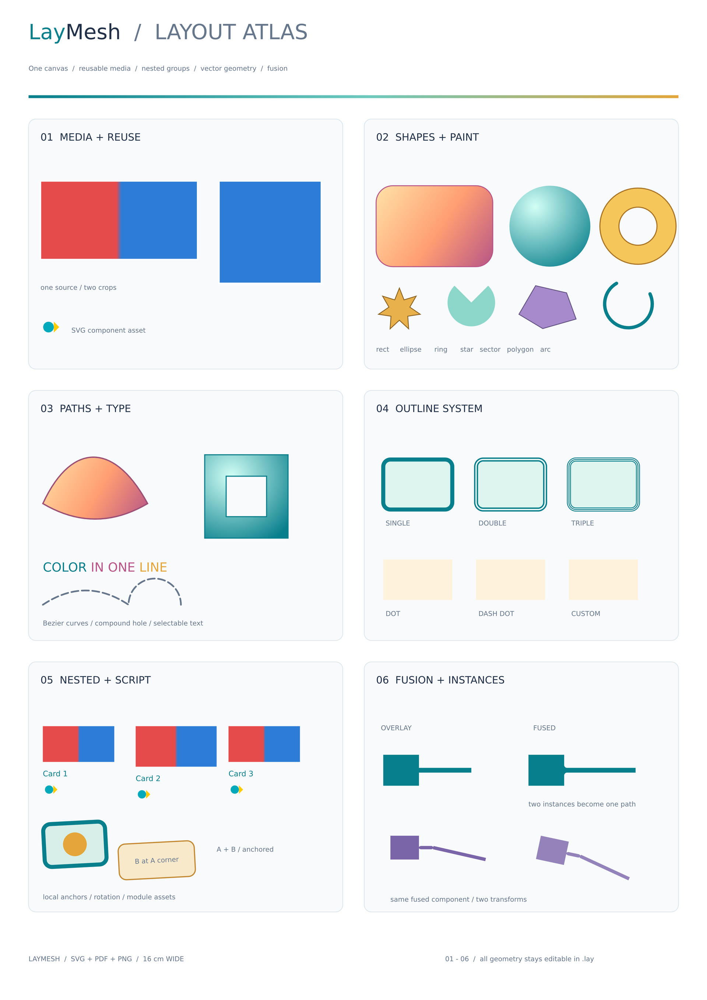

# LayMesh

[渐变对照画廊](https://muxkin.github.io/LayMesh/gradient-gallery.html)：30 组原始配方与跨端输出，附参考差异说明。

**用可读代码绘制科研图，按物理尺寸组织版面。** 一个可编辑项目可以组合原生图表、图片、矢量图形、文字和公式，生成静态图件或多页演示。

[在线文档](https://muxkin.github.io/LayMesh/) · [视频教程（Bilibili）](https://www.bilibili.com/video/BV1gpHn6eE4V) · [English](README.en.md) · [示例库](docs/sections/examples.zh-CN.md)



[展示图源码](examples/showcase.lay) · [开始使用](docs/sections/start.zh-CN.md)

## 安装与第一次预览

推荐安装 [VS Code 扩展](https://marketplace.visualstudio.com/items?itemName=Hyacine.laymesh-language)，或下载[匹配平台的 VSIX](https://github.com/muxkin/LayMesh/releases/latest)。平台包内置原生引擎，无需另外安装 Python、Rust 或 npm；Remote SSH 选择远程宿主平台的包。

打开工作文件夹，把下面保存为 figure.lay，执行 **LayMesh：打开预览**：

~~~lay
page = canvas(size=(120mm,90mm), background="#ffffff")
p = plot(size=(110mm,80mm),
         x=axis(label="Time (s)"), y=axis(label="Signal"))
p.line(x=[0,1,2,3], y=[1,3,2,4], label="Experiment")
p.legend(position="top_left")
page.add(p, offset=(5mm,5mm))
~~~

尺寸和位置默认 mm，字号和线宽默认 pt。显式单位包括 mm/cm/in/inch/pt/px；布局 px 使用 canvas.layout_dpi，导出 DPI 独立控制栅格密度。详见[单位与尺寸](docs/topics/units.zh-CN.md)。

## CLI、Python 与 Notebook

需要 Python 3.10+，平台 wheel 内置引擎和公式字体：

~~~sh
python -m pip install laymesh
python -m laymesh --version
laymesh validate figure.lay
laymesh render figure.lay -o figure.pdf
laymesh render figure.lay -o figure.png
~~~

~~~python
from laymesh import render_file
result = render_file("figure.lay", output="figure.pdf")
~~~

Notebook 先运行 %load_ext laymesh.ipython，再使用 %laymesh figure.lay 或 %%laymesh 编写版面。支持 NumPy/pandas 数据绑定、Matplotlib Figure 导入以及保存可独立复现的源码和资源。[安装与平台要求](docs/topics/install.zh-CN.md) · [Python API](docs/topics/python-reference.zh-CN.md) · [Notebook](docs/topics/notebook.zh-CN.md)

## 学习与查询

| 任务 | 完整说明 |
| --- | --- |
| 尺寸、锚点、分组、复用 | [第一张版面](docs/topics/first-layout.zh-CN.md) · [布局与素材](docs/sections/layout.zh-CN.md) |
| 折线、散点、误差、统计、热图、极坐标 | [第一张数据图](docs/topics/first-plot.zh-CN.md) · [科研绘图](docs/sections/plotting.zh-CN.md) |
| 主题、样式库、字体、渐变和阴影 | [样式与动画库：导入、逐项案例、第三方 CSS](docs/topics/style-libraries.zh-CN.md) · [样式完整手册](docs/topics/lcss.zh-CN.md) · [样式图库](docs/gallery/styles.zh-CN.md) |
| 97 个动画、关键帧、步骤与放映 | [动画完整手册](docs/topics/animation.zh-CN.md) · [效果目录](docs/topics/animation-catalog.zh-CN.md) · [综合案例](docs/topics/style-animation-examples.zh-CN.md) |
| 视频、页面音轨和跨页背景音乐 | [视频与音频](docs/topics/media.zh-CN.md) · [可运行示例](examples/media/README.md) |
| 编排独立页面和导出整本 PDF | [多页文档](docs/topics/documents.zh-CN.md) |
| 文字、公式、艺术字与效果 | [字体](docs/topics/fonts.zh-CN.md) · [公式](docs/topics/formulas.zh-CN.md) · [艺术字](docs/topics/art-effects.zh-CN.md) |
| SVG/PDF、图片、可编辑 PPTX、MP4/GIF | [静态导出](docs/topics/export.zh-CN.md) · [动画导出](docs/topics/animation-export.zh-CN.md) |

.lay 描述独立页面，.laydoc 编排多页；多面板显式定位。PDF 保留主体矢量，模糊效果局部栅格化。VS Code 导出只选择格式与路径，图片默认 1200 DPI、TIFF 默认 LZW，其余参数在设置中调整。视频导出需要 FFmpeg。

主题保存重复外观，.lay 保存尺寸、定位和数据；显式参数优先于样式。当前源码手册包含最新离线样式库及诊断改动，使用这些功能需包含相应改动的引擎构建；已发布包以[发布说明](https://github.com/muxkin/LayMesh/releases)为准。

## 文档与开发

[入门](docs/sections/start.zh-CN.md) · [语言参考](docs/language-reference.zh-CN.md) · [API](docs/api-reference.zh-CN.md) · [架构](docs/architecture.zh-CN.md) · [示例与历史执行结果](docs/examples-and-results.zh-CN.md)

源码开发需要 **Rust 1.93.1**；构建与发布脚本需要 Python 3.11+。在仓库根目录运行：

```sh
cargo build --release --locked -p laymesh-cli
python -m pip install -e './python'
python -m laymesh render examples/basic.lay -o basic.pdf
cargo test --workspace --locked
python -m unittest discover -s python/tests -v
```

无需 Python 时，可直接调用 `target/release/laymesh`（Windows 为 `laymesh.exe`）。[发布流程](release/README.zh-CN.md)包含 wheel 构建、包审计、隔离安装验证及 PyPI Trusted Publishing 配置。[文档站构建](site/README.md)使用 `python scripts/build-docs.py`，由 GitHub Pages 工作流发布。

LayMesh 使用 [MIT 许可证](LICENSE)。原生依赖、公式字体和配色数据保留各自许可，详见[第三方声明](release/THIRD_PARTY_NOTICES.md)。
