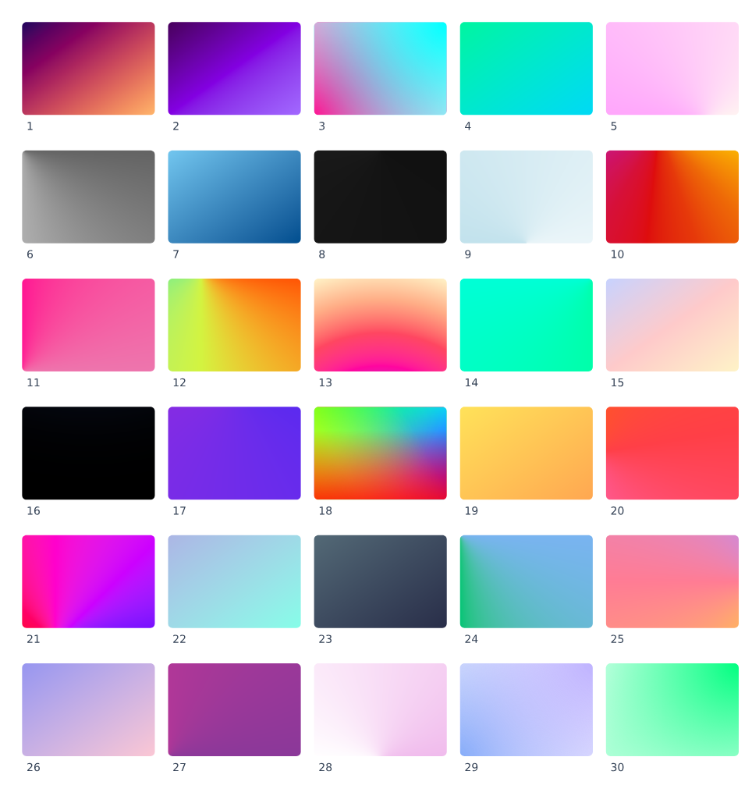

# 完整渐变与多层背景实现验证 · 2026-10-19

本次补齐统一渐变／色标／背景层模型、CSS 与 DSL 接口、原生和 CanvasKit 绘制、显示列表 v2、增量更新与局部导出兜底。原始 Open Props 30 组配方在默认 OKLab 和显式 sRGB 下均直接使用，一组一个 LayMesh 对象；未改写库 CSS。旧 `video/OpenProps-选题验证/v001/` 保留。本报告记录 0.7.1 工作区上的实现阶段验证；功能随后纳入 0.7.2，发行验收见 [0.7.2 更新说明](https://github.com/muxkin/LayMesh/releases/tag/v0.7.2)。原始构建哈希和测量记录保留，不改写历史测试版本。

[交互对照画廊](gallery.html) · [全部像素指标](verification.json) · [可编辑 30 组示例](../../../examples/libraries/open-props-gradients.lay) · [组合与艺术文字示例](../../../examples/manual/gradient-composition.lay) · [中文手册](../../topics/gradients.zh-CN.md) · [English guide](../../topics/gradients.en.md)



## 实现和测试边界

- 线性／径向／圆锥及全部重复形式，布局完成后解析物理位置；支持双位置、缺省位置、硬边、中点提示、越界色标、框外中心及径向退化。`gradient(css=...)` 为完整语法入口，`conic_gradient(stops,center=(0.5,0.5),angle=0deg)` 从正上方顺时针计算。
- 保留浮点源通道和 `none`，按 CSS Color 4 插值和透明度预乘，再映射到输出 sRGB；支持全部所列内建空间和四种色相路径。线性 P3 的缺失分量先在对应空间处理。复杂曲线由 Rust 自适应采样；两端渲染器消费相同几何和色标。
- 多层背景保留底色，支持图片混合、尺寸／位置／平铺、简写重置和级联恢复。对象路径／圆角裁切、透明度、描边、阴影仍位于对象层。图片资源更改和样式更改均与全量重编译对照。
- 显示列表 v2 增加圆锥着色器，仍读取 v1；跨版本更新替换完整基线。SVG／PDF／PPTX 无法准确表达的填充局部栅格化，保持独立描边和其他内容。仅当目标格式无法表达填充与描边的隔离透明度时，局部合成该对象，以免重叠位置重复施加透明度。正常局部兜底静默，技术原因保留在导出任务、SVG 标记和 PPTX 对象名称中；失败或内容损失仍使用原有错误／诊断通道。
- SVG 的配置 DPI、离线两种模式的圆锥填充与分块路径一并接通。修复 PDF device matrix 已含 DPI、再次相乘导致过度采样的问题，并增加 96／192 DPI 的嵌入图片尺寸回归。放映版多页 PDF 为资源 ID 增加页作用域；对 jsPDF 固定 21 点采样函数计算误差，超限才局部兜底，避免复杂色标被重新稀疏采样。

## 对照条件与结果

参考环境固定为 Chromium **151.0.7922.34**，sRGB，240 × 160 CSS px，deviceScaleFactor=1。主矩阵原生和局部填充导出为 96 DPI，所有矢量结果按 96 DPI 读回。SVG 由同一 Chromium 绘制；PDF 使用 Poppler Cairo；PPTX 经 LibreOffice 25.2.3.2 的无损 PDF 过滤器转换，关闭图片降采样，再由 Cairo 绘制。没有图像配准或缩放来掩盖偏移。

共 **119 例**：60 个原始配方实例、59 个通用语义实例。平滑区域剔除两像素页边，以及相邻像素通道跳变超过 12/255 的边缘周围两像素；同时保留全图和边缘指标。

| 与原生比较的实际输出 | 完整用例数 | 平滑区域最大通道误差 | 超过 3/255 的平滑像素 |
| --- | ---: | ---: | ---: |
| CanvasKit CPU | 119 | 2/255 | 0 |
| SVG | 119 | 3/255 | 0 |
| PDF / Cairo | 119 | 3/255 | 0 |
| PPTX / LibreOffice → Cairo | 119 | 3/255 | 0 |

Open Props 两套 30 组全部编译、渲染、导出，零条渐变声明被忽略。与浏览器 CSS 直接比较，第 18 组在每套各有 **1 个平滑像素达到 4/255**；其余原始配方的原生结果均不超过 3/255。这两点保留为量化差异，不算作严格的 3/255 达标。

[WebGL 记录](webgl.json)另测 9 例，全部平滑区域不超过 3/255。当前机器提供的是 ANGLE / SwiftShader 软件驱动的 WebGL2，不能据此声称已经覆盖实体 GPU。圆角抗锯齿的全图最大差异较大，单独计入边缘指标。

另保留 Poppler **Splash** 的读回结果（JSON 中 `pdf-splash`、`pptx-splash`）。它与 Cairo 对图片插值的结果不同，一些重复渐变超过 3/255；部分 PPTX 内嵌 PNG 与原生像素完全相同。该结果保留用于区分导出数据与阅读器采样差异，不能推广为所有 PDF／PowerPoint 阅读器均逐像素一致。未在 Microsoft PowerPoint 本体测试。

## 六个浏览器参考差异

下列例子不参与“浏览器逐像素一致”的结论；它们在各 LayMesh 输出之间仍通过主矩阵阈值。

| 用例 | 当前浏览器行为与验证方式 |
| --- | --- |
| `hint`、`hint-auto` | Chromium 用九个插入色标近似中点提示；实现遵循标准幂函数，逐像素独立公式测试误差不超过 1/255。省略位置分配保留已定位的提示为锚点。 |
| `round` | Chromium 对百分比定位使用调整前的平铺尺寸；实现按最终尺寸定位。`round-zero` 对照仍一致。 |
| `radial-zero-width` | CSS 标准要求零宽椭圆形成镜像水平渐变；该 Chromium 将其画成末色。独立几何和跨端对照验证标准行为。 |
| `zero-repeat` | 标准要求重复周期为零时取平均颜色；红／白／蓝应为 `(0.75,0.5,0.75)`，该 Chromium 使用末色。 |
| `calc-size` | 此 Chromium 拒绝两个混合长度／百分比的 `calc()` 半径，`CSS.supports=false`，computed background 为 `none`。240×160 下等价半径为 110px、69px；代入这两个数后的浏览器参考与原生最大通道误差为 1/255，画廊保留原式白图并附加等价参考。 |

依据：[CSS Images 渐变](https://www.w3.org/TR/css-images-4/#gradients)、[径向退化与重复平均色](https://www.w3.org/TR/css-images-3/#degenerate-radials)、[CSS Color 4](https://www.w3.org/TR/css-color-4/#interpolation)、[CSS Backgrounds](https://www.w3.org/TR/css-backgrounds-3/)、[Chromium 渐变实现](https://raw.githubusercontent.com/chromium/chromium/main/third_party/blink/renderer/core/css/css_gradient_value.cc)、[Chromium 背景定位](https://raw.githubusercontent.com/chromium/chromium/main/third_party/blink/renderer/core/paint/background_image_geometry.cc)。PPTX 转换条件采用 [LibreOffice PDF CLI 参数](https://help.libreoffice.org/latest/en-US/text/shared/guide/pdf_params.html)。

## 回归、离线与生命周期

Rust 主回归 674 项通过、2 项原有忽略；后续受影响模块的 90 项定向回归通过，并单独重跑 17 项 PPTX（包括填充／描边透明度只合成一次）、图层图片缓存、动画寻帧、预览协议及导出 DPI。VS Code 预览协议 10 项通过；实际导出命令的 API stub 使用未保存文档、依赖与圆锥填充，验证仍只出现格式和路径两个选择步骤。10 个既有 PPTX 示例的包结构和编辑性检查通过；最终构建的三个箭头示例导出检查通过。

[旧 CSS 回归](css-regression.json)同时验证字体、阴影、局部覆盖和原生／WASM 输出。SVG 结构一致，颜色浮点序列化最大差异为 0.0000456；栅格全图平均通道误差为 0.0355/255，抗锯齿差异另计。

[离线导出](offline.json)在阻断全部 HTTP(S) 的条件下，实际下载可编辑版、放映版的 SVG／PDF／PNG：零联网请求、零页面异常。综合示例包含旧渐变、圆锥、多层底色、描边、圆角、纹理、蒙版与阴影；[综合画面对照](offline-parity.json)全图平均误差小于 0.8/255，包含各端抗锯齿和已有滤镜差异，不将它称为每个像素都小于 3/255。渐变艺术文字另通过可编辑组合示例验证。

[完整离线矩阵](offline-matrix-parity.json)另将全部 **119 页**打包为可编辑版和放映版，阻断 HTTP(S)，实际下载整套 SVG 和多页 PDF 后重新渲染。两种模式、两种格式共 476 页画面全部满足相对原生平滑区域最大通道误差 ≤ 3/255，零新增导出警告、零联网请求；[构建哈希](offline-build.json)与[下载记录](offline-matrix.json)一并保留。

默认 1200 DPI 下，先预热一次以建立编辑器持久 worker 基线，再取消并连续导出三轮：[可编辑版记录](lifecycle-editable.json)、[放映版记录](lifecycle-playback.json)。取消响应分别 30 ms、35 ms，完成／取消后的 worker 数量均回到基线；两种模式均可继续导出。三次结束后的进程 RSS 分别约 877.1／871.4／878.1 MiB 和 892.7／885.4／892.7 MiB，未呈现逐轮累积。放映版最大分块 RGBA 预算为 21,590,272 bytes，低于 64 MiB。此结论限于本次三轮与 119 × 30 次重复预览，不等同于无限时长泄漏证明。

## 同环境性能记录

[原始测量](performance.json)比较改动前 0.7.1 二进制与[最终工作区构建](build.json)。停止本任务构建和浏览器测试后，交替执行两者，每项预热两轮、记录九轮；旧用例各含 160 个矩形，输出 144 DPI PNG。计时包含进程启动、编译、绘制和编码，CPU／峰值 RSS 来自每个子进程的 `wait4`，不将其解释为纯渐变着色耗时。

| 用例 | 旧版中位耗时 | 本次中位耗时 | 变化 | 旧版／本次峰值 RSS |
| --- | ---: | ---: | ---: | ---: |
| 旧 `linear_gradient` 构造器 | 51.794 ms | 51.692 ms | -0.20% | 24.8 / 25.3 MiB |
| 旧 CSS 线性渐变 | 56.864 ms | 59.525 ms | +4.68% | 25.7 / 27.5 MiB |

新增完整 Open Props 30 组画廊的中位耗时为 187.350 ms，峰值 RSS 39.0 MiB。旧版会忽略其中 19 组，工作量不同，未使用该用例作速度提升比较。本次旧 CSS 路径有小幅总耗时增加；这些数据是同机短批次记录，不是普遍的性能保证。

## 复现

在仓库根目录运行；`PLAYWRIGHT_MODULE` 可指向已安装的 Playwright。网站预览服务绑定 Tailscale 地址。

```sh
cargo test -p laymesh-core -p laymesh-render -p laymesh-language -p laymesh-playback --lib --tests
python3 scripts/build-web-export.py
cargo build --release --locked -p laymesh-cli
python3 scripts/build-docs-live.py --output target/gradient-compatibility/runtime/site/live
python3 scripts/serve-preview.py --bind 100.64.0.6 --port 18737 --directory target/gradient-compatibility/runtime
```

另一个终端生成全矩阵，再添加 CanvasKit 读回；不要在期间重建或替换正在测量的二进制。

```sh
LAYMESH_TEST_BINARY=target/release/laymesh GRADIENT_VECTORS=1 node scripts/test-gradient-parity.cjs target/gradient-compatibility/recheck
GRADIENT_NATIVE=0 GRADIENT_RUNTIME_URL=http://100.64.0.6:18737/site/live/manifest.json node scripts/test-gradient-parity.cjs target/gradient-compatibility/recheck
node scripts/render-gradient-vectors.cjs target/gradient-compatibility/recheck
python3 scripts/analyze-gradient-parity.py target/gradient-compatibility/recheck --vectors --check
LAYMESH_GRADIENT_FIXTURE=1 LAYMESH_TEST_ENGINES=chromium node scripts/test-web-vector-export.cjs target/gradient-compatibility/offline
LAYMESH_TEST_ENGINES=chromium node scripts/test-web-pdf-performance.cjs target/gradient-compatibility/offline/editable.zip.html target/gradient-compatibility/lifecycle-editable
LAYMESH_TEST_ENGINES=chromium node scripts/test-web-pdf-performance.cjs target/gradient-compatibility/offline/playback.zip.html target/gradient-compatibility/lifecycle-playback
node scripts/test-gradient-offline.cjs target/gradient-compatibility/offline-matrix --matrix target/gradient-compatibility/recheck
python3 scripts/analyze-gradient-offline.py target/gradient-compatibility/recheck target/gradient-compatibility/offline-matrix --check
```

性能可用 `python3 scripts/benchmark-gradients.py BASELINE_BINARY CANDIDATE_BINARY OUTPUT_DIRECTORY` 复测，期间避免并行构建或浏览器测试。

每例 `.lay`、浏览器 computed CSS、原始图片和导出文件保存在运行目录；`verification.json` 和自包含画廊可以单独分享。`--check` 明确列出浏览器参考差异和第 18 组的单像素容差，不静默忽略其他失败。中英文 API、69 项静态属性、97 项效果、381 项能力覆盖与 Open Props 目录已同步；原始库哈希为 `4bc9bec663eb7fef2cb7680d2983e21f0f79778a61a77bee74224030dc981f5c`。
