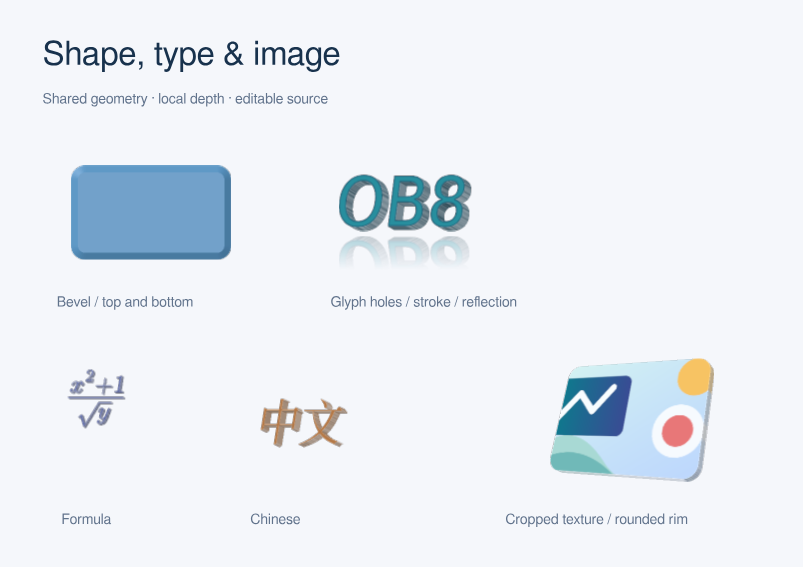

# 静态效果与对象级三维验证

0.8.0 发布前重新检查及侧面颜色修复见[发布验证](release-0.8.0/README.zh-CN.md)。以下保留历史批次。

后续的缩放清晰度、侧面条纹修复与重新导出文件，见[最新质量验证](zoom-quality/README.zh-CN.md)。以下保留初次实现时的验证记录。

本记录对应 2026-10-19 的本地开发实现，未发布版本。新增 `reflection()`、`soft_edge()`、`three_d()` 及 `@laymesh/effects.css` 的 30 个预设。完整用法见[效果文档](../../topics/art-effects.zh-CN.md)。



## 实现范围

Rust 共享可见轮廓处理、保孔洞三角剖分、厚度／前后斜面、XYZ 旋转、正交／透视投影、法线光照和带深度缓冲的软件光栅化；Skia／CanvasKit 负责二维纹理与页面合成。图像轮廓沿用实际裁剪及圆角，前后旋转使用同一纹理平板。不同对象按页面图层合成，不建立整组三维场景。

显示列表 v3 读取 v1/v2；语言补全、LCSS、Python 源码接口、VS Code 内联 worker 与离线运行时均已接通。三维／柔边主体局部图片化，可分离的倒影、阴影和发光独立输出；普通文本在 PPTX 中保持可编辑。`.lay` 保存三维参数，不输出 PowerPoint 原生三维设置。

## 已执行检查

| 检查 | 证据与结果 |
| --- | --- |
| Rust 全量回归 | `cargo test --workspace --quiet`：721 项通过，0 失败，2 项忽略；含旧阴影、发光、渐变与二维挤出回归；[记录](workspace.json) |
| 几何与错误 | 凹形、孔洞、中文、公式、描边、圆角裁剪图片、正反面；无效相机、退化轮廓和斜面明确报错 |
| 原生／WASM CPU | 同源 9 例，360×270 px；最大平均 RGBA 差 0.04844/255，无通道差超过 8 的像素通道；[记录](browser-cpu.json) |
| WebGL 路径 | Chromium 的软件驱动，最大平均差 0.13757/255；不是物理 GPU 认证；[记录](browser-webgl.json) |
| SVG | 浏览器实际解码导出 SVG；逐例与 PNG 对照；同步 WASM SVG 另测，均在 2/255 平均通道差阈值内 |
| PDF／PPTX | 10 例含组合场景；Poppler 渲染对照最大平均 RGB 差分别为 1.10353、1.03662/255；[记录](exports.json) |
| PPTX 往返 | 包内 XML、关系、ID、图片链接正确；局部图片小于页面面积的 80%；LibreOffice 打开并重新保存，文本内容／数量及图片数量保留 |
| VS Code | 真实扩展宿主，阻断 worker 外部资源请求，组合源码实际显示；深浅色、缩放、平移、增量更新、重新加载及中英文 UI 回归；[记录](vscode.json) |
| 离线 HTML | 真正的 `file://` 独立文件；斜面示例和同一 `object-3d.lay` 组合均显示；[截图](offline.png) |
| 缓存 | 重复渲染复用纹理；放大重新生成；修改两个对象中的一个，仅替换其纹理。原生 retained renderer 与浏览器分别验证 |
| 高 DPI／预算 | 1024 px 分块接缝、纹理取样相位、64 MiB 工作块、256 MiB 缓存；超像素预算及不可构造几何失败不覆盖已有文件 |
| Python | 新效果的源码保存／重放、PPTX 文本与局部图片、非法相机失败保留已有文件，两项测试通过 |
| 预设与文档 | 30 个独立 `.lay` 均编译；30 个样式均纳入已验证样式库；386 项公开表面无文档遗漏；画廊筛选、源码下载内容与 375 px 布局通过，覆盖 HTTP 及 [file:// 离线打开](gallery-file.json) |
| 浏览器导出包 | 增量 299677 bytes，小于原有 307200 bytes 上限；[记录](web-export-budget.json) |

逐例首帧和复用耗时保存在浏览器记录中，是本机测量，不作为通用帧率承诺。软件 CanvasKit 下组合柔边仍有明显滤镜成本；缓存测试验证的是网格／纹理的复用与失效范围。

PowerPoint 实机未测试，未标为通过；无折射、全局光照、跨对象投影或三维动画。本轮未发布任何版本。

## 复现

在仓库根目录运行，Rust/WASM 工具链与 Playwright、LibreOffice、Poppler 沿用项目测试环境：

```sh
python scripts/build-web-export.py
cargo build -p laymesh-cli
python scripts/build-editors.py --binary target/debug/laymesh
python scripts/build-docs-live.py --output /tmp/laymesh-effects-browser/site/live
python scripts/build-effects-gallery.py --binary target/debug/laymesh
cargo test --workspace
cargo test -p laymesh-render --no-default-features --test surface_svg
PYTHONPATH=python LAYMESH_CLI="$PWD/target/debug/laymesh" python -m unittest discover -s python/tests -p test_object_effects.py
python scripts/build-library-docs.py --check
python scripts/check-feature-docs.py
node scripts/test-display-update.mjs
```

浏览器工具为本仓库 Playwright 测试；本次未能取得内置 Browser 的执行工具，因此使用已有测试方式。服务只绑定 Tailscale IPv4。先在一个终端运行：

```sh
LAYMESH_TAILSCALE_IP=$(tailscale ip -4)
python scripts/serve-preview.py --bind "$LAYMESH_TAILSCALE_IP" --port 18791 --directory /tmp/laymesh-effects-browser
```

再运行（`PLAYWRIGHT_MODULE` 可指定本机 Playwright 路径）：

```sh
LAYMESH_TAILSCALE_IP=$(tailscale ip -4)
node scripts/test-object-effects.cjs "http://$LAYMESH_TAILSCALE_IP:18791/" examples/output/effects3d/browser
LAYMESH_BROWSER_GPU=1 node scripts/test-object-effects.cjs "http://$LAYMESH_TAILSCALE_IP:18791/" examples/output/effects3d/browser-gpu
python scripts/test-effects-exports.py --binary target/debug/laymesh
python scripts/test-vscode-preview.py --output examples/output/effects3d/vscode --block-worker-resource-fetch --object-effects
node scripts/test-effects-gallery.cjs "file://$PWD/examples/output/effects3d/gallery/index.html" examples/output/effects3d/gallery-qa
```

[30 项预设源文件清单](../../../examples/effects/presets.json) · [源码校验和](source-sha256.json) · [30 项对照图](presets.png)。生成的完整画廊、各格式文件和截图位于 `examples/output/effects3d/`，不纳入发布。
