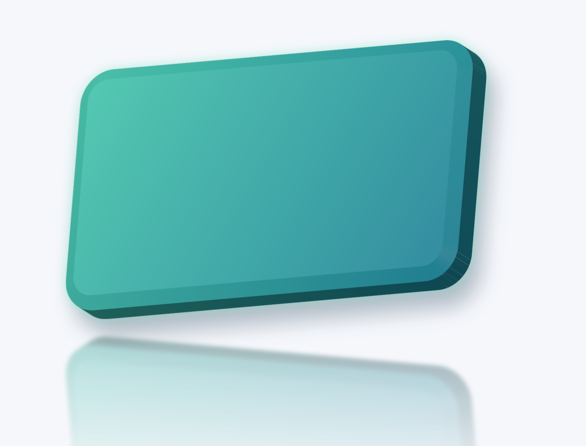

# 0.8.0 发布前验证

本次同时复查对象三维、网页缩放及动画资源优化。原始附件、初次实现记录和失败样本保留；本记录只汇总 0.8.0 候选的重新验证。

## 三维侧面颜色修复

原来的覆盖度修复消除了透明度条纹，但边缘像素经预乘与反预乘后仍有 RGB 量化误差，会沿厚度拉成细条。600 DPI 的圆角渐变金属对象复现了这一现象。无装饰的纯色对照曾出现最大 31/255 的内部颜色误差；约 10% 透明度对照曾出现 6.118/255 的预乘颜色误差。两个失败记录均保留。

材质恢复现在只采用与量化误差相容的内部颜色，保留真实颜色边界。已知均匀透明度优先于边缘字节反推的透明度区间；透明图片仍保留自身透明像素。光照、圆角、斜面、倒影、阴影和发光的作者参数没有改变。

修复前，同一源码、600 DPI：

修复后，同一源码、600 DPI：

原始无损 PNG：[修复前](side-before.png) · [修复后](side-after.png)。

原生回归逐一检查所有具有完整几何覆盖的内部像素，不用整页平均掩盖局部条纹；不透明及 alpha=26/128/200 的预乘颜色误差阈值为 2/255。真实红蓝纹理边界和透明图片有独立保护检查。

## 发布验证记录

最终候选的 [构建与验收汇总](summary.json) 包含文件 SHA-256、原始 64 项作品资源保留结果及逐项运行命令。此前全量合同为 726 项 Rust、70 项 Python 合同，891 项历史断言映射检查通过；补充透明度修复后，18 项相关原生测试和以下浏览器矩阵全部重跑。发布提交的跨平台 CI 另由 GitHub Actions 留档。

| 检查 | 最终候选结果 |
| --- | --- |
| 3D 原生／WASM | [CPU](object-cpu.json) 与 [物理 GPU](object-hardware.json) 各 12 例；凹形、孔洞、中文、公式、描边、圆角图像和正反面覆盖；纯色及半透明侧面逐像素检查 |
| PDF／PPTX／SVG | [13 例](exports.json)；LibreOffice 打开、往返、普通文字可编辑及局部图片范围通过；PowerPoint 实机未测 |
| 真正离线编辑 | [两份效果文件 × 三浏览器](offline.json)，6 组修改源码、保存和重新打开通过 |
| 缩放与视口 | [12 组浏览器/DPR](zoom.json)；25%—800%、377%、适应页面；过期提交、清晰度拼接及缩放编译均为零；[24 个可见区域](visible.json)和[视口生命周期](lifecycle.json)通过 |
| 动画合成 | [Chromium](native-composition-chromium.json)、[Firefox](native-composition-firefox.json) 的半透明、旋转、延迟呈现及资源释放通过；三个浏览器的直接／缓存画面对照通过 |
| VS Code | 实际扩展宿主中，阻断 Worker 外部取资源的对象效果与转场两条路径均通过 |

实际 GPU：`ANGLE (AMD, Vulkan 1.4.305 (AMD Radeon Graphics (RADV PHOENIX) (0x00001900)), radv)`。软件和硬件结果分开，未使用 SwiftShader 结果代替物理 GPU 认证。

## 同一最终文件的自然播放

每组从第一页立即开始，自然播放全部 26 页两轮；没有全篇预热或跳过作品时长。以下是当前候选复测，[逐页、阶段与资源数据](performance.json)单独保留。历史同机对照在下方链接中，不将不同批次直接当成同时实验。

| 环境 | 完成页次 | 已准备切页 P95 / ms | 稳定帧提交 P95 / ms | PSS 峰值 / MiB | DRM VRAM / MiB | 静止重复绘制 |
| --- | --- | --- | --- | --- | --- | --- |
| chromium 1920 · Skia CPU + Canvas2D | 52/52 | 36.4 | 1.1 | 1264.0 | 未测 | 0 |
| chromium 1920 · Skia WebGL2 | 52/52 | 34.7 | 2.0 | 1119.2 | 387.6 | 0 |
| chromium 3840 · Skia CPU + Canvas2D | 52/52 | 90.1 | 28.1 | 1898.3 | 未测 | 0 |
| chromium 3840 · Skia WebGL2 | 52/52 | 59.5 | 2.6 | 1127.8 | 1249.5 | 0 |
| firefox 1920 · Skia CPU | 52/52 | 55.0 | 9.0 | 1578.2 | 未测 | 0 |
| firefox 3840 · Skia CPU | 52/52 | 152.0 | 30.0 | 2293.7 | 未测 | 0 |

Firefox 的后端字段保留初始化时的 `Skia CPU` 标识；运行期资源计数确认两组均启用了 Canvas2D 原采样密度合成。六组第二轮均完整观察到绘制请求，新增对象／静态缓存、效果绘制、效果录制重放及 CPU 分块转换全部为零；没有通过丢弃活动帧减少这些计数。各阶段和资源生命周期计数保留在 `performance.json`。

PSS 是浏览器进程树占用；DRM 是本机驱动内存域驻留，不能与逻辑纹理字节相加，也不等同于独立显卡板载显存。提交耗时、GPU 查询、回复间隔与物理扫描输出不同。性能目标按实测数字解释；成功遍历不意味着每帧满足 16.67 ms。

原附件保留 64 项源码、字体、资源和显示列表；没有新增固定页数、内存或显存配额，没有降低分辨率、删减效果或缩短作品时间。

复现命令见仓库的 `scripts/test-object-effects.cjs`、`scripts/test-effects-editable.cjs`、`scripts/test-zoom-quality.cjs`、`scripts/test-zoom-visible.cjs` 和 `scripts/test-openprops-performance.cjs`；`summary.json` 保留本轮完整参数。自然播放应串行执行，避免其他构建或浏览器批次干扰测量。

动画实现与原始同机对照见[动画资源优化后续记录](../../animation-resources-2026-10-19/followup.zh-CN.md)。WebKit 动画性能仍按用户要求暂缓；三维功能和缩放的 WebKit 检查与此分开。4K 软件路径的 60 Hz 目标和部分冷页延迟仍有局限，不将成功遍历等同于全部性能指标达标。PowerPoint 实机未测，LibreOffice 往返不替代它。
