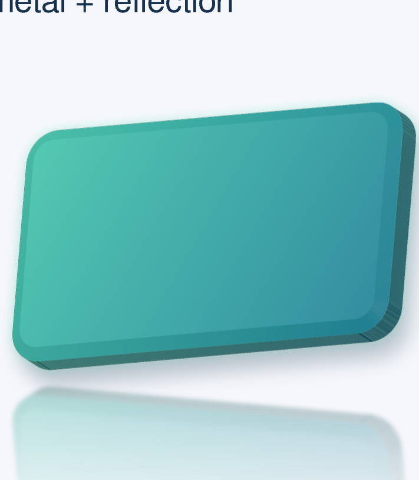
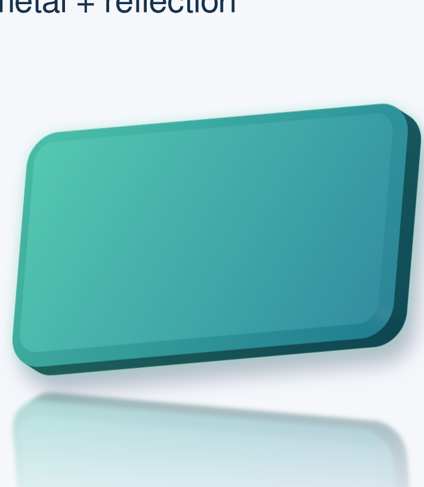

# 网页缩放与三维侧面质量修复

0.8.0 发布前重新检查及侧面颜色修复见[发布验证](../release-0.8.0/README.zh-CN.md)。以下保留历史批次。

2026-10-19 的本地验证构建，未发布版本。两份可编辑文件已替换为新内嵌运行时；旧离线文件不会自动更新。运行服务时仅绑定 Tailscale 地址。可访问 `/quality/` 查看截图对照和新文件入口。

## 问题与修复

- **过期画面提交**：原先内容序号没有区分视口变化，400% 的晚到位图可能在用户已停到 200% 时提交。现在内容和视口分别标识，位图、视口、像素尺寸、倍率及完成状态一次性提交；过期位图关闭并丢弃。一个正在执行的重绘结束后自动处理最新请求，保留 80 ms 合并窗口。
- **混合清晰度**：交互中整体移动已经提交的画面；覆盖不足时只显示整幅概览占位。高清画面覆盖全部可见区域后统一替换，不再用低清概览填补局部高清画面的周围。
- **圆角侧面条纹**：固定 UV 偏移把二维轮廓的抗锯齿覆盖度带入了侧面材质。现在独立处理几何覆盖度和材质 Alpha，并为已知恒定透明度的矢量材质保留精确 Alpha；纹理边缘按覆盖度延展，透明图片保留自身透明度。平滑曲面插值法线，原始硬角保持硬边。
- **曲线与采样**：从可选的 v3 几何配方重建网格，按屏幕误差细分；使用 4×4 覆盖／深度采样。纹理密度同时考虑二维变换、DPR 和三维透视。预算不足时继续细分工作块。旧列表没有配方时仍可绘制原网格。
- **刷新遗漏与无效计算**：DPR 媒体查询和现有帧时钟共同检查屏幕密度变化；后台恢复刷新当前视口。静态对象按包含装饰的边界提前剔除，柔边及反射层限制实际工作范围。重绘失败保留上一幅完整有效画面；成功恢复后清除当前错误状态，历史原因留在诊断。

`.lay` 接口没有变化。柔边、发光、阴影和倒影的模糊没有被删掉或调小。

## 画面对照

同一对象、377%、DPR 1。前后原始 PNG 可点击查看；后图中的倒影模糊来自源码设置。

| 修复前 | 修复后 |
| --- | --- |
|  |  |

另外检查了实际可见的圆角侧面，而非放大后只显示空白页面：

[Chromium 800% / DPR 3](after-800-dpr3.png) · [Firefox 同倍率](firefox-800-dpr3.png) · [WebKit 同倍率](webkit-800-dpr3.png)。

## 验证结果

| 项目 | 结果与证据 |
| --- | --- |
| 主缩放矩阵 | Chromium、Firefox、WebKit × DPR 1、1.25、2、3；适应页面、25%、50%、100%、200%、377%、400%、800%，共 96 个状态；[记录](verification.json) |
| 过期与拼接 | 27 个过期结果被丢弃；过期提交 0，概览／高清拼接帧 0，单纯缩放的源码编译次数 0 |
| 连续操作 | 往返缩放、滚轮缩放接平移、窗口调整、实际拖动编辑器分隔条；停止操作后检查最新视口完整覆盖 |
| 冷／热画面对照 | 377% 对绿色板、字形、圆角图片、独立对象组分别比较；阈值平均通道差 <1/255、差值 >8 的通道占比 <1%，三浏览器通过 |
| 高倍率可见侧面 | 377%、800% × 四种 DPR × 三浏览器，共 24 个状态；要求画面中有绿色主体、覆盖完整且无概览残留；800% 同一最终视口冷启动／多次缩放后逐通道完全一致；[记录](visible.json) |
| 动态 DPR／恢复 | Chromium 真实 DPR 切换 1→1.25→2→3→1；CDP frozen→active；Worker 和主线程备用路径均通过。注入绘制错误时位图与放置状态均保持不变，后续绘制成功恢复，诊断保留原因；[记录](lifecycle.json) |
| 真正离线编辑 | 两份交付文件在三浏览器中阻断所有 HTTP 请求；修改可见标题、保存、重新打开，标题源码持久化，重开不需编译；6 组通过；[记录](editable.json) |
| Rust | `cargo test --workspace --quiet`：725 通过、0 失败、2 忽略。三维专项 17 项，包含无装饰平涂对照、半透明侧面、透明图片、孔洞、中文、公式、描边、正反面、非法几何、精度、法线、旧网格、分块接缝及预算 |
| 原生／WASM／SVG | 9 组像素对照通过；重复绘制复用纹理，修改一个对象保留另一个对象纹理；同步无 native 特性的 SVG 专项通过；[记录](parity.json) |
| 导出 | PNG、SVG、PDF、PPTX 的 10 组对照通过；局部图片、普通文本可编辑性、LibreOffice 打开及往返保存通过；[记录](exports.json) |
| VS Code | 真实扩展宿主、阻断 worker 外部资源请求；实际组合对象、缩放、平移、调整窗口、资源变化及增量编辑回归通过；[记录](vscode.json) |
| 文档与包体积 | 386 项特性无文档遗漏；播放导出包保持原有 300 KiB 增量门槛；[记录](web-budget.json) |

没有 PowerPoint 实机环境，未将 PowerPoint 实机验收标为通过。Firefox／WebKit 的前后台标签切换另有记录；明确的 frozen→active 自动化生命周期检查在 Chromium 上执行。

## 性能与内存边界

以下是本机自动化测试的实测值，包含软件驱动／软件渲染，不是通用帧率承诺。高倍率可见圆角的最慢完整重绘：Chromium 2.16 s、Firefox 21.74 s、WebKit 3.28 s。Firefox 在 800% / DPR 3 下仍明显较慢；交互期间保留已有整幅画面，不能把本次质量修复称为所有性能问题均已解决。

工作缓冲保守计量峰值 53.74 MiB（上限 64 MiB），三维纹理缓存峰值 21.26 MiB（上限 256 MiB）。Rust WASM 内存峰值 72 MiB，CanvasKit WASM 堆峰值 184.38 MiB。Linux 测试进程树 RSS 求和峰值约 2.61 GiB，500 ms 采样，包含测试驱动，且共享页会重复计数；该值不是单个纹理缓存或工作块的大小。数值与逐帧分项见[汇总](summary.json)和[可见侧面记录](visible.json)。

## 复现

使用仓库现有 Rust/WASM、Playwright、LibreOffice 和 Poppler 环境。此次内置 Browser 执行工具不可用，使用仓库的 Playwright 测试方式。

```sh
python scripts/build-web-export.py
cargo build -p laymesh-cli
python scripts/build-editors.py --binary target/debug/laymesh
python scripts/build-docs-live.py --output /tmp/laymesh-effects-browser/site/live
cargo test --workspace --quiet
cargo test -p laymesh-render --no-default-features --test surface_svg
node scripts/test-display-update.mjs
python scripts/check-web-export-budget.py
python scripts/check-feature-docs.py

target/debug/laymesh render examples/effects/combined-effects.lay -o combined-effects.zip.html --html-editable --html-embed-fonts
target/debug/laymesh render examples/effects/presets.lay -o effects-30-presets.zip.html --html-editable --html-embed-fonts
node scripts/test-zoom-quality.cjs combined-effects.zip.html /tmp/zoom-quality
node scripts/test-zoom-visible.cjs combined-effects.zip.html /tmp/zoom-visible
node scripts/test-viewport-lifecycle.cjs combined-effects.zip.html /tmp/viewport-lifecycle
node scripts/test-effects-editable.cjs combined-effects.zip.html effects-30-presets.zip.html /tmp/offline-editable
```

`PLAYWRIGHT_MODULE` 可指定本机模块路径。原生／WASM、导出、VS Code 复现命令沿用[原效果验证记录](../README.zh-CN.md)。源码与文件身份见[源码校验和](source-sha256.json)、[交付校验和](artifacts.json)。最终两份文件在保留项目资源的情况下用 `scripts/refresh-web-runtime.mjs` 换入最终运行时；交付哈希与浏览器验证输入哈希完全相同。
