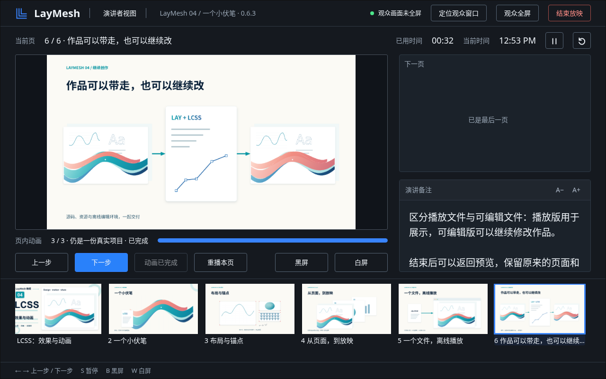

# 演讲者视图多屏、画面复用与进度验证（v004）

> 当前入口已改为普通全屏，演讲者模式与窗口位置由用户手动选择；见 [v006 记录](presenter-manual-v006.zh-CN.md)。

后续 v005 修复了启动授权、主副屏分配与准备阶段异常，并收紧实际窗口位置的验收；见 [v005 记录](presenter-screens-v005.zh-CN.md)。下文保留 v004 历史结果，其中虚拟屏测试不代表实际落屏验证通过。


2026-10-14，Linux 本地验证。版本号仍为 0.6.3；没有发布、推送或改写已有标签。保留原附件和 v003，重新导出的实际六页作品位于 `video/04-LCSS与动画/exports/v004/04_LCSS_离线播放_v004.zip.html`。[v003 历史记录](presenter-playback.zh-CN.md) 中的控制台重复绘制已被本次实现替换。

## 实现与边界

- 主放映从当前页开始。单屏使用原窗口全屏；具备屏幕管理能力且授权成功的扩展多屏环境自动进入演讲者模式。原窗口作为观众端，先申请目标屏全屏，再打开操作屏控制台，之后准备页面。三屏以上提供目标列表，当前会话保留选择；仅幻灯片、窗口放映与手动演讲者入口仍可用。
- `screen.isExtended` 与 `getScreenDetails()` 区分能力与设备状态。拒绝授权或不支持接口时回退到普通放映，不声称检测到单屏。普通 Tailscale HTTP 不属于安全上下文，自动屏幕管理不可用；手动演讲者可用。[W3C 启动顺序](https://w3c.github.io/window-management/#usage-multi-screen)、[MDN 接口限制](https://developer.mozilla.org/en-US/docs/Web/API/Window/getScreenDetails)。
- 控制台只接收位图及权威状态，不加载 CanvasKit、不调用动画采样或场景绘制。观众端在正常渲染或 GL 转场 flush 完成后复制画面；不调用会重新绘制并读取 RGBA 的 `capture` 接口。镜像最多 1280px 宽、15fps，一帧在途；复制较慢时降到 10/5fps。隐藏时停止复制，恢复、暂停及完成后补送当前画面。
- 下一页和缩略图在观众端共用同一个 CanvasKit 实例，空闲时生成；控制台虚拟列表缓存上限 32MiB。静态缩略图仍有绘制开销，位图复制和传输也不是零成本。
- 进度由有效步骤最后结束时间计算，包含末尾停留的总时长只用于自动导航。实际第六页动画在 6 秒完成、总时长 7 秒，控制台自然播放结束时显示 100%；自动模式最后 1 秒另显示等待切页。减少动态效果使用对应步骤表。
- 暂停、完成和放映结束立即发送状态。另修复退出全屏 Promise 在虚拟显示器移除后不结束的问题：退出清理也观察实际 `fullscreenchange`，不让已退出的观众画面阻塞控制台关闭。
- 屏幕断开暂停播放；控制台关闭不结束观众放映，重开保留页码和计时。弹窗与全屏失败提供直接恢复入口；镜像故障保留最后画面和提示。诊断不会被常规状态刷新覆盖。

## 浏览器与宿主检查

验证流程：打开实际离线作品 → 从当前页放映 → 控制台操作并观察原窗口 → 动画自然结束 → 结束放映恢复预览。Browser 插件所需的 Node REPL/浏览器执行工具未提供，本次按项目现有 Playwright 工作流验证；没有新装浏览器依赖。自动化未禁用浏览器弹窗拦截。

| 项目 | 结果与证据 |
| --- | --- |
| 六页自然播放 | Chromium、Firefox、WebKit 均通过，逐页等待动画自然结束，没有以跳到总时长代替。第六页 6/7 秒时进度 1；减少动态效果也为 1。[记录](presenter-playback/v004/natural.json) |
| 显示画面对比 | 三浏览器控制台镜像与观众实际画面下采样到 64×36 后，RGBA 平均绝对差分别约 0.46、0.45、0.41/255。允许缩放插值差异，没有二次渲染作为参照 |
| 控制与恢复 | 三浏览器通过步骤、暂停、重播与导航、黑白屏、独立计时及归零、控制台关闭重开、全屏退出不结束、结束恢复、弹窗拦截和全屏失败。控制台没有 `CanvasKitInit` 或当前页渲染器。[记录](presenter-playback/v004/browsers.json) |
| 虚拟多屏 | Chromium CDP 单屏、三屏自动模式、手动改选、选择保留、移除观众屏、授权拒绝和接口缺失。没有把该测试当作物理双屏验收。[记录](presenter-playback/v004/screens.json) |
| GL、后台与释放 | 实际 GL 转场的中间合成帧进入镜像钩子；快速跳页仅显示最后目标；模拟 document visibility 隐藏／恢复，WebGL 真实 lose/restore 事件通过。12 次交替导航，预热后的 CanvasKit 与播放 WASM 线性内存不增长；结束释放镜像和静态渲染器。[记录](presenter-playback/v004/lifecycle.json) |
| 自动停留 | 自然播放进入 holding 时进度 1，剩余停留小于等于 1 秒；随后正常 ended，终态不受状态限频影响。[记录](presenter-playback/v004/lifecycle.json) |
| 逐页采样回归 | 三浏览器各六页 × 五个时刻，无播放错误，备注保留。[记录](presenter-playback/v004/pages.json) |
| 百页缩略图 | DOM 少于 15 项，缩放、键盘导航、折叠及窄屏抽屉通过；解码缓存 32,916,000 字节（31.4MiB），26 项，释放 30 个旧 URL。[记录](presenter-playback/v004/thumbnail-cache.json) |
| 网页 HTTP | 三浏览器通过 `http://100.64.0.6:8774/preview/04-lcss-v004.zip.html` 当前页普通放映和手动演讲者双窗口。无页面异常。[记录](presenter-playback/v004/http.json) |
| VS Code | 实际扩展既有 16 项回归通过；外部浏览器从指定页启动、控制台黑屏控制、退出清理、不重复编译、第一页损坏不阻塞第二页通过。[原生预览](presenter-playback/v004/vscode.json)、[外部浏览器](presenter-playback/v004/external.json) |
| 界面与构建 | 1672×941、1366×768、600×900，实际截图无空白应用、错误遮罩、水平溢出；缩略图标题不被滚动条遮住。228 个文档媒体源指纹检查通过 |

上述浏览器测试使用 Linux Playwright。Chromium 为 SwiftShader 软件 GPU，Firefox/WebKit 使用 CPU 降级。**尚未验证物理双／三屏、投影设备、硬件 GPU、Windows/macOS 的原生浏览器。** 屏幕权限提示的人工点击未自动化；权限分支由 CDP 设置授权／拒绝验证。VS Code 的原有报告仍为 `page_transition_verified: false`，不把它计入这次 GL 镜像画面验收。

布局延续确认的深色设计：左侧当前页、右侧下一页／备注、底部缩略图。窄窗口纵向滚动；没有拉伸幻灯片。新旧差异为观众全屏按钮、屏幕列表及完成态按钮文字。



## 性能与体积

同一份六页作品的最后一页，1280×800，动画自然运行约 6 秒。三种模式串行运行，静态预览预热完成后采样。CPU 为 CDP 所列浏览器进程 CPU 秒数之和；内存为 Linux `/proc` PSS 之和，含浏览器和软件 GPU，不能视为单个渲染器内存。每种模式一次运行，数值用于本机诊断，不是跨设备性能承诺。

| 模式 | 观众采样帧数 | 控制台额外场景绘制 | CPU 秒 | 请求完成 P95 | 采样 P95 | 绘制调用 P95 | 结束 PSS |
| --- | ---: | ---: | ---: | ---: | ---: | ---: | ---: |
| 普通放映 | 245 | 0 | 50.09 | 33.3ms | 0.5ms | 1.4ms | 1046.1MiB |
| 旧演讲者 v003 | 200 | 78 | 39.47 | 2.1ms | 0.6ms | 1.5ms | 1070.3MiB |
| 位图镜像 v004 | 257 | 0 | 52.07 | 28.4ms | 0.7ms | 27.6ms | 1060.7MiB |

新模式传输了 51 帧，最多一帧在途；复制／异步等待累计 976.4ms，结束时镜像限频为 10fps。控制台额外绘制 78 → 0；相对普通放映，CPU 约增加 4.0%，观众采样帧数约增加 4.9%。**没有测得相对旧模式的总 CPU 减少**：旧模式观众帧数也较低。新模式不再重复计算场景，但位图复制、GPU 同步和控制台显示仍有开销。

“请求完成”测量 `paint` 调用往返；“绘制调用”是同步调用墙钟时长。新模式在观众主线程完成回调中启动位图复制，其等待计入该调用；旧模式主要异步向 Worker 提交 GPU 工作。这两列不是纯 GPU 执行时长，不能据此推断硬件 GPU 帧率。上述 CanvasKit 堆均为 128MiB；新模式播放 WASM 堆还包含共享静态预览数据。完整数值见 [性能记录](presenter-playback/v004/performance.json)。

最终六页 v004 为 **4,179,040 字节（3.99MiB）**，相对 v003 增加 **5,578 字节（5.45KiB）**；相对原 v002 增加 **221,753 字节（216.56KiB）**。[文件校验值](presenter-playback/v004/size.json)。

现有导出功能预算为 **260,885 字节（254.77KiB）**，低于 307,200 字节（300KiB）。该保守口径包含导出模块、控制台／侧栏及相关样式、ZIP 条目和新增许可，不计基础渲染器及作品内容；上面的实际文件对比另外包含本次基础放映模块改动，二者不相加。[预算明细](presenter-playback/v004/export-budget.json)。

播放版仍保留 PDF、SVG、PNG、JPEG、TIFF；可编辑版格式不变。没有新嵌入一套渲染器、字体、图片或整套缩略图，也没有新增 CDN 依赖。

## 重现

先构建 `scripts/build-web-export.py --skip-wasm`、`scripts/build-docs-live.py --skip-wasm` 与 `scripts/build-editors.py --binary target/release/laymesh`（仅在对应 WASM 和原生二进制已按源码构建时使用 skip）。使用现有 `PLAYWRIGHT_MODULE` 路径。

```sh
node scripts/test-presentation-clock.mjs
node scripts/test-presentation-session.mjs
node scripts/test-presenter-mirror.mjs
node scripts/test-presenter.cjs /tmp/laymesh-presenter-v004/qa
node scripts/test-presenter-natural.cjs PATH_TO_V004.zip.html
node scripts/test-presenter-lifecycle.cjs PATH_TO_V004.zip.html
node scripts/test-presenter-screens.cjs PATH_TO_V004.zip.html
node scripts/test-page-thumbnails.cjs /tmp/laymesh-presenter-v004/qa
node scripts/test-presentation-pages.cjs PATH_TO_V004.zip.html /tmp/laymesh-presenter-v004/pages
node scripts/test-presentation-host.cjs /tmp/laymesh-presenter-v004/served
node scripts/measure-presenter.cjs PATH_TO_V003.zip.html PATH_TO_V004.zip.html
python scripts/test-vscode-preview.py --output /tmp/laymesh-presenter-v004/vscode --block-worker-resource-fetch
python scripts/check-web-export-budget.py
python scripts/build-docs-media.py --check
```
