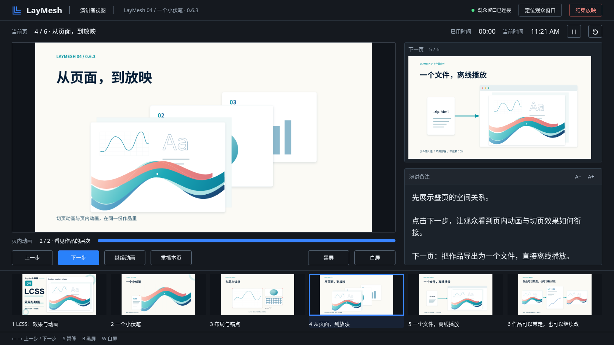

# 播放修复与演讲者视图验证（v003）

> 当前入口已改为普通全屏，演讲者模式与窗口位置由用户手动选择；见 [v006 记录](presenter-manual-v006.zh-CN.md)。

后续 v004 已改为原窗口观众放映、附属控制台位图镜像；最新行为、自然播放、性能与体积记录见 [v004 验证](presenter-mirror.zh-CN.md)。下面保留 v003 的历史验证，不代表当前仍使用双重动画渲染。

2026-10-14，Linux 本地验证。版本号保留 0.6.3，没有发布、推送或重新打标签。原始 `04_LCSS_离线播放_v002.zip.html` 保留；修复后的六页作品在 `video/04-LCSS与动画/exports/v003/04_LCSS_离线播放_v003.zip.html`。该目录属于本地视频作品，不加入发行包。

## 已实现的行为

- 绘制动画保留中心线，按弧长裁切后复用描边与端点生成。起点箭头固定、终点箭头跟随前端；进度零隐藏墨迹，完成态直接使用原始绘制命令。无适用描边的对象产生一次 `W_ANIMATION`，仅跳过 `draw` 属性，保留其他动画与时序。
- 主入口从当前页开始，菜单另有从头窗口／全屏放映。目标页优先准备，首次显示不触发页间转场；退出恢复预览。
- 播放版左侧缩略图默认 220px，支持 160–480px 拖动、键盘调整与折叠；窗口缩窄时主预览保留至少 320px。缩略图按可见范围生成、等比缩放，清晰图在调整后更新。图片缓存上限 32MiB，底层每个预览渲染器最多保留三页（单页特别大时可超出软内存预算）。
- 演讲者控制台与观众窗口通过随机会话标识、版本校验、来源校验和 MessageChannel 通信。观众窗口维护播放状态，控制台限频重绘；下一页和缩略图保持静态。资源按需传输并按标识去重，观众端保留最近三页资源，额外资源预算 64MiB，不重复嵌入第二份渲染器。
- 顶层独立三引号语句成为本页只读讲稿；赋值、调用参数、嵌套语句及导入文件不收集。备注不参与画面渲染。

使用说明：[从当前页放映与演讲者视图](../topics/presenter.zh-CN.md)。可运行示例：[demo.laydoc](../../examples/animation/presenter/demo.laydoc)。

## 验证结果与范围

| 检查 | 结果 |
| --- | --- |
| 核心动画、备注解析、原生动画渲染、语言检查 | 19 + 2 + 7 + 8 项通过。渲染测试还遍历原有 97 个效果 |
| 箭头与路径 | 六种箭头 × 实线／虚线；双端、复合描边、曲线、闭合路径、多子路径、父组变换。起点为空、前端位置检查、终态与静态像素一致 |
| 不适用的绘制动画 | 纯填充、零长度、零宽度、无描边；警告去重、延迟、后继动画顺序和 opacity 属性保留 |
| 原六页作品 | Chromium、Firefox、WebKit，各六页 × 五个采样时刻（0、20%、50%、80%、100%），无播放错误；六页备注均在元数据中 |
| 旧文件兼容 | 原 v002 页面数据配合新版运行时：第五页一个、第六页两个中心线警告；对象静态显示，可继续播放，无逐帧重复警告。原附件未改写 |
| 离线双窗口 | 三浏览器均通过当前页开始、双向同步、步骤／暂停、黑屏、独立计时、计时归零、关闭后重连、全屏退出不结束、弹窗拦截提示和结束恢复。无 HTTP 请求、无页面或控制台错误 |
| 资源共用 | 三浏览器验证：销毁一个缩略图渲染器后，另一个渲染器仍能加载使用同一图片的新页面 |
| 百页导航 | 虚拟列表 DOM 少于 15 项；拖动后补充清晰图、键盘 End/Enter 跳至第 100 页、选中状态、折叠、窄窗口抽屉以及主预览最小宽度通过 |
| 网页原有放映回归 | 窗口／全屏、自动模式、白屏、失败重试、冻结文档版本、主线程降级和渲染上下文恢复通过 |
| VS Code 原生预览 | 实际扩展通过原有 16 项回归，含编辑、图片资源、页选择、动画、导出、多预览及受限 Worker 资源路径；无控制台错误 |
| VS Code 外部浏览器 | 原生编译后在 Tailscale 服务读取资源；从指定第二页进入全屏和演讲者视图，控制观众窗口黑屏，退出清理，导航不重复编译。另测第一页损坏、第二页有效时，第二页仍能准备完成 |
| 备注隔离 | 两种三引号、多块、中文、缩进、赋值、参数、函数、条件、循环、导入；有／无备注的 SVG、PNG 完全一致，PDF 经 Poppler 渲染后像素一致 |
| 文档媒体 | `build-docs-media.py --check`：228 个媒体源通过；更新了渲染器指纹和新示例媒体 |

浏览器验证使用 Linux 的 Playwright 引擎。六页检查中，Chromium 使用 WebGL2 软件驱动；Firefox 与 WebKit 使用 Skia CPU 降级。**未验证 Windows/macOS 的原生浏览器、真实双显示器、投影设备和硬件 GPU。** 浏览器引擎通过不等于这些实际设备已验收。测试中的 VS Code 自动报告 `page_transition_verified: false`；此处不把它计为新转场画面验收。

百页目录在 DPR 2 下滚动遍历 11 个分散范围后，缩略图解码缓存为 32,916,000 字节（31.4 MiB），保留 26 项，释放 29 个旧图 URL，低于 32MiB。[缓存记录](presenter-playback/thumbnail-cache.json)。

可核查记录：[双窗口](presenter-playback/browsers.json)、[逐页采样](presenter-playback/pages.json)、[外部浏览器](presenter-playback/external.json)、[已有放映路径](presenter-playback/existing-playback.json)、[实际 VS Code](presenter-playback/vscode.json)。

## 设计对照

按已确认的深色稿，在 1672×941 同尺寸检查真实作品；另检查 1366×768 与 600×900。



| 对照项 | 实现与核对 |
| --- | --- |
| 大布局 | 当前页在左；右侧上方下一页、下方可滚动备注；底部六页缩略图与快捷键。位置和层级与确认稿一致 |
| 留白与比例 | 桌面左右边距 32px，中间间隔 24px，左右列约 1.94:1；页面使用 contain，保留原始尺寸比例 |
| 色彩与层级 | 炭黑背景、深灰面板、细边框、浅色正文、低强调说明文字、蓝色主按钮与选中框；连接状态绿色 |
| 字号与密度 | 顶部品牌 22px、页标题 17px、计时 18px、备注默认 20px；备注可调至 14–32px，内部独立滚动 |
| 控制与状态 | 顶部定位／结束，独立计时暂停／归零；下方上一步、下一步、暂停、重播、黑白屏；真实进度与选中缩略图同步 |
| 认可的内容差异 | 用 LayMesh 原标识代替概念稿中的临时图标；幻灯片、页名、备注和步骤数使用实际作品。实际作品比例与概念图不同，空白边缘用于完整显示，未拉伸或裁切内容 |

已修复对照中发现的缩略图选中样式被通用按钮规则覆盖，以及改变窗口尺寸后下一页预览未重新清晰渲染的问题。未把概念图嵌入成产品界面。

## 体积

两个口径分别记录，不相加或混称为同一个基线：

1. **同一六页实际文件**：原附件 3,957,287 字节，新文件 4,173,462 字节，增加 **216,175 字节（211.1 KiB）**，包含本次几何修复、控制台、缩略图、通信与六页备注。作品内容不同会改变增量。[文件字节数和 SHA-256](presenter-playback/size.json)。
2. **现有导出功能预算**：将新控制台、侧栏和通信模块纳入 `check-web-export-budget.py`。该保守口径计算导出模块、播放器界面／样式、ZIP 条目和新增许可，不计作品资源与基础渲染器；本次为 **255,943 字节（249.9 KiB）**，见[预算明细](presenter-playback/export-budget.json)，小于 300KiB。基础渲染器本次为箭头几何修复增加的代码已包含在上面的实际文件对比中，没有用该预算冒充完整文件大小。

播放版仍保留 PDF、SVG、PNG、JPEG、TIFF。当前页、下一页与缩略图使用同一个现有 CanvasKit 模块，离线包没有新增预先渲染的整套缩略图，没有 CDN 依赖。

## 重现主要检查

先执行 `python scripts/build-web-export.py`、`cargo build -p laymesh-cli --release` 和 `python scripts/build-editors.py --binary target/release/laymesh`。Playwright 可通过 `PLAYWRIGHT_MODULE` 指向现有安装，无需修改项目依赖。

```sh
cargo test -p laymesh-core --test animation --test speaker_notes
cargo test -p laymesh-render --test animation
cargo test -p laymesh-language --lib
node scripts/test-presentation-clock.mjs
node scripts/test-presentation-session.mjs
node scripts/test-presenter.cjs /tmp/laymesh-presenter-qa
node scripts/test-page-thumbnails.cjs /tmp/laymesh-presenter-qa
node scripts/test-presentation-host.cjs /tmp/laymesh-presenter-qa/served
node scripts/test-presentation-pages.cjs PATH_TO_V003.zip.html /tmp/laymesh-pages presentation
python scripts/check-web-export-budget.py
python scripts/build-docs-media.py --check
```

网页检查服务仅绑定 `100.64.0.6:8774`。没有自动发布或重新创建已有版本标签。
