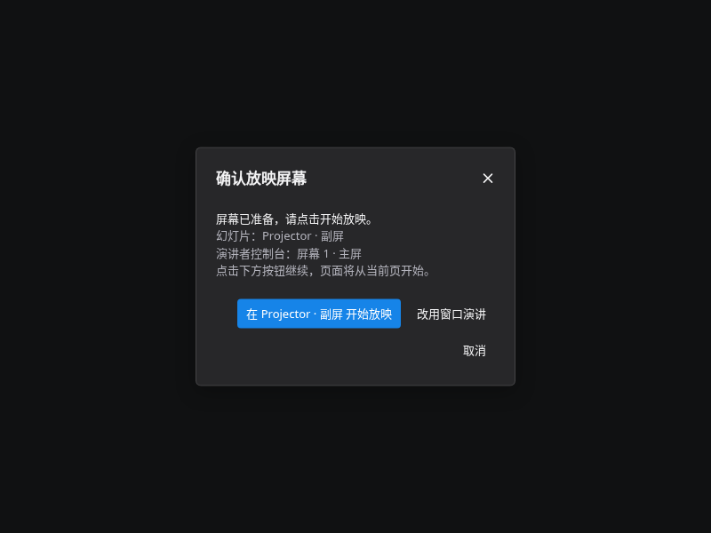

# v005 主副屏放映修复与验证

> 历史实现记录。v006 按用户选择移除了自动选屏与移屏；当前规则见 [手动安排窗口](../topics/presenter.zh-CN.md)。

## 变更与故障证据

v004 有三个相关缺陷：`PresentationClock` 未初始化 `duration`，准备期间的可见性事件会触发 `undefined.toFixed()`；等待屏幕授权后没有检查临时用户激活；通过 MessageChannel 转发全屏命令时没有在观众窗口取得新的用户激活。旧屏幕测试仅验证选择名称及全屏元素，漏掉实际落屏位置。

v005 默认主屏控制台、副屏幻灯片，使用 `isPrimary` 分配默认角色，使用 `currentScreen`、屏幕几何与控制台窗口边界检查实际位置。手动选择优先于默认规则，当前会话保留选择；内置、外接与主副屏分别处理。复制模式或只有一个独立显示区域时不自动开控制台；接口不可用或授权拒绝显示“无法检测”，不推断系统模式。

启动顺序为指定屏幕全屏 → 打开控制台 → 准备作品。屏幕授权耗尽临时激活时显示确认面板；拒绝或超过 5 秒未确认时保留恢复入口且不打开控制台。控制台的全屏／切屏命令只要求观众窗口确认，由真实点击完成申请。全屏、位置、连接和渲染诊断分别保存。退出或扩展失效时保留进度并清理附属窗口和资源。

## 测试环境与结论

Linux，Playwright Chromium 151.0.7922.34、Firefox、WebKit，以及系统 Microsoft Edge 146.0.3856.84。软件渲染；弹窗拦截保持开启。Browser 插件缺少可调用的执行接口，使用项目现有 Playwright 工作流，未安装浏览器依赖。

| 检查 | 结果与边界 |
|---|---|
| 初始化、主副屏分配、从不同屏幕启动的规则、系统主屏变更 | 纯状态测试通过；这些结果不是物理窗口移动测试 |
| 负坐标、内置／外接、手动选择、交换、重复几何、重复授权变化 | 状态与缓存回归通过；不同 DPR 的虚拟显示器参与入口测试 |
| 授权等待 5.5 秒、已有授权、拒绝、请求超时、弹窗拦截 | Chromium 与 Linux Edge 验证恢复流程；没有无用户激活的全屏调用 |
| 屏幕选择、交换、拔屏、失去扩展区域 | 验证确认入口、暂停、进度保留和控制台关闭 |
| 真实窗口落屏 | **未验证**。无界面 Chromium/Edge 能枚举虚拟屏，却仍报告观众窗口位于原屏；部分重复全屏请求不返回。产品保留“尚未确认”提示，测试不将该结果计为落屏成功 |
| Windows Edge 物理双屏／三屏、系统复制切换、真实 GPU | **未覆盖**；需要实机验证，不能用虚拟屏或 Linux 结果替代 |
| 离线页面身份、非空界面、无错误覆盖层、控制台异常 | Chromium、Firefox、WebKit 通过；离线测试没有网络依赖 |
| 备注、导航、镜像、计时、黑白屏、退出恢复、窄窗口 | 三引擎回归通过，覆盖 1672×941、1366×768、600×900 |
| 实际六页作品自然完成、减少动态效果、进度 100% | 三引擎通过；不靠跳到总时长模拟完成 |
| GL 中间帧镜像、快速导航、上下文恢复、隐藏镜像和内存上限 | 生命周期回归通过，控制台不加载第二套 CanvasKit |
| VS Code 外部浏览器服务与当前页入口 | 原生服务回归通过，绑定 Tailscale；未作 Windows VS Code 桌面实测 |
| Tailscale 网页入口 | 验证当前页、普通全屏、不可检测提示和退出恢复；HTTP 的能力限制明确显示 |

## 体积与交付

最终 v005 为 **4,183,177 字节（3.99 MiB）**，比 v004 增加 **4,137 字节（4.04 KiB）**，比 v002 增加 **220.60 KiB**。保守功能预算为 **258.29 KiB**，低于 300 KiB。

体积、SHA-256 与旧附件对比见 [size.json](presenter-playback/v005/size.json)；300 KiB 预算见 [export-budget.json](presenter-playback/v005/export-budget.json)。没有增加渲染器或字体副本、网络依赖及整套缩略图。

作品：`video/04-LCSS与动画/exports/v005/04_LCSS_离线播放_v005.zip.html`。原附件、v003、v004 保留；未发布、未提交版本标签。

Tailscale 预览：<http://100.64.0.6:8774/preview/04-lcss-v005.zip.html>。检测物理双屏请下载离线文件，在支持屏幕管理的浏览器中授权后验证。

## 重现与证据

```sh
node scripts/test-presentation-clock.mjs
node scripts/test-presentation-screens.mjs
node scripts/test-presentation-session.mjs
node scripts/test-presenter-mirror.mjs
python scripts/build-web-export.py --skip-wasm
python scripts/build-docs-live.py --skip-wasm
python scripts/build-editors.py --binary target/release/laymesh
node scripts/test-presenter-startup.cjs PATH_TO_V005.zip.html /tmp/startup.json
node scripts/test-presenter.cjs /tmp/presenter-qa
node scripts/test-presenter-natural.cjs PATH_TO_V005.zip.html /tmp/natural
node scripts/test-presenter-lifecycle.cjs PATH_TO_V005.zip.html /tmp/lifecycle.json
node scripts/test-presentation-host.cjs /tmp/served
python scripts/check-web-export-budget.py
python scripts/build-docs-media.py --check
```

`skip-wasm` 仅适用于对应 Rust/WASM 已构建且源码未变化的情形。本次只修改浏览器模块，没有修改此前的 Rust/WASM 实现。

原始测试记录：[启动](presenter-playback/v005/startup.json)、[Edge](presenter-playback/v005/edge-startup.json)、[离线三引擎](presenter-playback/v005/presenter-results.json)、[自然播放](presenter-playback/v005/natural.json)、[生命周期](presenter-playback/v005/lifecycle.json)、[扩展失效](presenter-playback/v005/topology.json)、[原生外部服务](presenter-playback/v005/external.json)、[网页入口](presenter-playback/v005/served-web.json)。

实际恢复面板：


