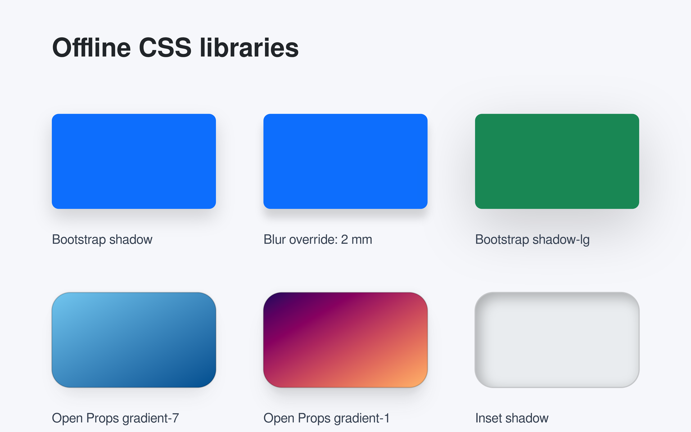
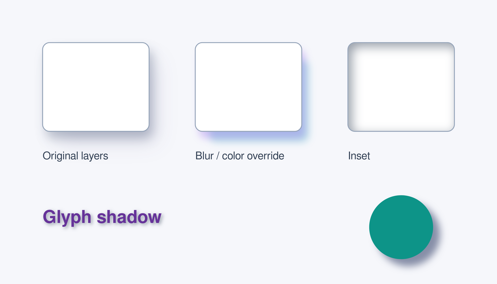
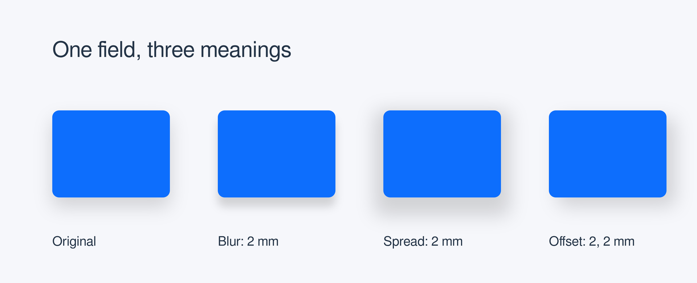

# CSS 样式库与阴影

离线原样导入样式库，按项目单位调整外观和阴影。

## 样式与效果

<a id="libraries"></a>

### Bootstrap 与 Open Props

使用库配色、圆角、渐变和阴影，再局部覆盖模糊半径。

动画另行加载 `@laymesh/animate.css`。点击“放映”后，`start="after-previous"` 自动播放渐变卡片入场；若省略此参数，进入放映后点击画面或按空格启动。

```lay
# Bootstrap 5.3.8, Open Props 1.7.23 and Animate.css 4.1.1 are embedded offline.
page = canvas(size=(160mm,100mm), stylesheet=["@laymesh/bootstrap.css","@laymesh/open-props.css","@laymesh/animate.css"], background="#f6f7fb")
style {
  .card { border-radius: var(--radius-3); }
  .ocean { background: var(--gradient-7); box-shadow: var(--shadow-3); }
  .sunset { background: var(--gradient-1); box-shadow: var(--shadow-4); }
  .inset { background-color: var(--gray-2); box-shadow: inset 1mm 1mm 3mm #0004; }
  .shadow.custom { box-shadow-blur: 2mm !important; }
  .caption { font-size: 3mm; color: #364152; }
  .heading { font-size: 6mm; font-weight: 700; color: var(--gray-9); }
}
heading = page.add(text("Offline CSS libraries",class="heading"),target=page.top_left,offset=(12mm,8mm))

function sample(appearance,label) {
  card = group()
  plate = card.add(rect(size=(38mm,22mm),class=appearance))
  card.add(text(label,class="caption"),target=plate.bottom_left,offset=(0mm,3mm))
  return card
}
function row(samples,origin,gap) {
  cards = []
  for appearance,label in samples {
    target = origin
    offset = (0mm,gap)
    if len(cards) > 0 {
      target = cards[len(cards)-1].top_right
      offset = (11mm,0mm)
    }
    item = page.add(sample(appearance,label),target=target,offset=offset)
    cards = append(cards,item)
  }
  return cards
}
first = row([
  ("bg-primary rounded shadow","Bootstrap shadow"),
  ("bg-primary rounded shadow custom","Blur override: 2 mm"),
  ("bg-success rounded shadow-lg","Bootstrap shadow-lg")
],heading.bottom_left,12mm)
second = row([
  ("card ocean","Open Props gradient-7"),
  ("card sunset","Open Props gradient-1"),
  ("card inset","Inset shadow")
],first[0].bottom_left,10mm)

# Start the first animation when entering Present; static preview stays complete.
sunset = second[1]
s1 = page.step(name="CSS library reveal", start="after-previous", hold=1s)
s1.animate(sunset, class="animate__animated animate__fadeInUp")
```



源码：[libraries.lay](../../examples/gallery/styles/libraries.lay). 也可参考项目 [theme.lcss](../../examples/manual/theme.lcss)，把三套库的显式导入和局部覆盖集中管理。

复现命令：`laymesh validate examples/gallery/styles/libraries.lay`; `laymesh render examples/gallery/styles/libraries.lay -o libraries.png --dpi 150`.

实测：场景保持毫米尺寸并完成编译；库中暂不支持的声明按文件集中显示 `W_CSS`。

<a id="layers"></a>

### 多层、内阴影与局部修改

保留阴影其他参数，分别调整各层；比较盒阴影、文字阴影与 drop-shadow。

```lay
page=canvas(size=(140mm,80mm),background="#f6f7fb")
style {
  .card { background-color:white; border:0.25mm solid #94a3b8; border-radius:2mm; box-shadow:1mm 2mm 3mm #192c4e40,3mm 4mm 6mm -1mm #2e2a6820; }
  .card.tuned { box-shadow-blur:2mm; box-shadow-color:#7c3aed40,#0891b240; }
  .card.inset { box-shadow:inset 1mm 1mm 3mm #33415580; }
  .label { color:rebeccapurple; font-size:5mm; font-weight:700; text-shadow:0.4mm 0.4mm 1mm #33415580; }
  .drop { background-color:#0d9488; filter:drop-shadow(2mm 2mm 1mm #17255480); }
}
cards = []
for appearance,label in [("card","Original layers"),("card tuned","Blur / color override"),("card inset","Inset")] {
  target = page.top_left
  gap = (12mm,12mm)
  if len(cards) > 0 {
    target = cards[len(cards)-1].top_right
    gap = (13mm,0mm)
  }
  item = page.add(rect(size=(30mm,25mm),class=appearance),target=target,offset=gap)
  cards = append(cards,item)
  page.add(text(label,font_size=3mm,color="#334155"),target=item.bottom_left,offset=(0mm,5mm))
}
page.add(text("Glyph shadow",class="label"),target=cards[0].bottom_left,offset=(0mm,21mm))
page.add(ellipse(size=(18mm,18mm),class="drop"),anchor=top_center,target=cards[2].bottom_center,offset=(0mm,18mm))
```



源码：[layers.lay](../../examples/gallery/styles/layers.lay).

复现命令：`laymesh validate examples/gallery/styles/layers.lay`; `laymesh render examples/gallery/styles/layers.lay -o layers.png --dpi 150`.

实测：场景保持毫米尺寸并完成编译；库中暂不支持的声明按文件集中显示 `W_CSS`。

<a id="shadow-parameters"></a>

### 2mm：模糊、扩散还是偏移

同一库阴影分别只改一个字段，保留颜色及其他参数。

```lay
# The same Bootstrap shadow; each variant changes one field only.
page = canvas(size=(160mm,65mm), stylesheet="@laymesh/bootstrap.css", background="#f6f7fb")
style {
  .caption { font-size:3mm; color:#243447; }
  .heading { font-size:5mm; color:#243447; }
  .shadow.blur { box-shadow-blur:2mm !important; }
  .shadow.spread { box-shadow-spread:2mm !important; }
  .shadow.offset { box-shadow-offset:2mm 2mm !important; }
}
heading = page.add(text("One field, three meanings",class="heading"),target=page.top_left,offset=(12mm,8mm))
variants = [("","Original"),("blur","Blur: 2 mm"),("spread","Spread: 2 mm"),("offset","Offset: 2, 2 mm")]
cards = []
for modifier,label in variants {
  target = heading.bottom_left
  gap = (0mm,11mm)
  if len(cards) > 0 {
    target = cards[len(cards)-1].top_right
    gap = (11mm,0mm)
  }
  item = page.add(rect(size=(27mm,20mm),class="bg-primary rounded shadow "+modifier),target=target,offset=gap)
  cards = append(cards,item)
  page.add(text(label,class="caption"),target=item.bottom_left,offset=(0mm,6mm))
}
```



源码：[shadow-parameters.lay](../../examples/gallery/styles/shadow-parameters.lay).

复现命令：`laymesh validate examples/gallery/styles/shadow-parameters.lay`; `laymesh render examples/gallery/styles/shadow-parameters.lay -o shadows.png --dpi 150`.

实测：四组使用相同的卡片物理尺寸，覆盖后保留未修改的阴影字段。
