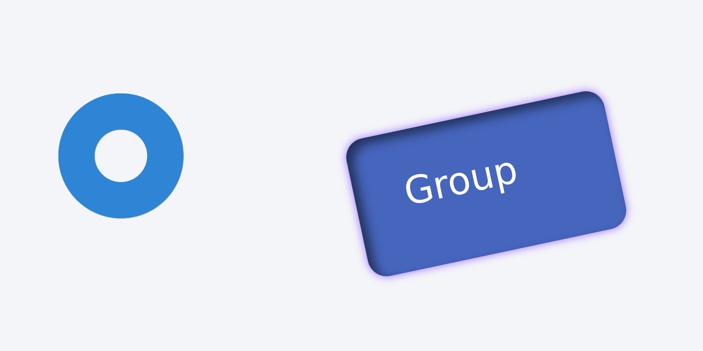

# 纯 Rust 渲染器迁移实验结果

基于干净的 `main`（`9c6f26f`）建立 `codex/rust-renderer-migration`。新默认链路为 `Scene → DisplayList v1 → Vello CPU 0.3.0 / krilla 0.8.2 / DrawingML`，本轮未发布版本。CLI、Python 和现有导出函数签名保持兼容。

## 实现与兼容边界

- 绘制指令使用毫米坐标，携带路径、画笔、定位字形及字符区间、编码图片、变换、裁剪、遮罩和效果。普通文字共用 Rust 字体选择和整形；公式、SVG 文字和艺术字保留源文本。
- 所有位图编码器消费同一份 Vello CPU RGBA；现有 DPI、TIFF、WebP 等设置继续生效。输出按 1024 像素分块，保持 100,000,000 像素上限；宽图图片资源也分块并处理采样重叠。
- Rust Alpha 层实现阴影、发光、内阴影及扩散；效果块带模糊重叠，单块最多 16,000,000 RGBA 像素，累计效果预算最多 100,000,000 像素。
- PDF 直接写路径、定位字形、字体子集、渐变和图片，主体保持矢量，效果局部栅格化；正文搜索、公式和艺术字源文本复制、16 位 PNG/Alpha、PDF 图片压缩策略已通过现有合同。PPTX 直接生成 DrawingML，保留编辑对象、原始 JPEG 与局部回退诊断。
- VS Code 与网页通过 WASM CPU 绘制 Canvas，按缩放、可见区域和 DPR 重绘，inspection 继续提供坐标、拾取和标尺。协议 3 是默认，新客户端不自动退回 SVG；协议 1/2 及 WASM `svg()` 仅作为显式兼容接口。
- `resvg`、`krilla-svg` 和内部 SVG 解析路径已移除。SVG 文件导入仍先进行既有安全校验，再由 usvg 适配为绘制指令；文件导出保留专门序列化代码。原安全子集限制保持不变。
- 扩展内置 WASM 和公式字体，正文由原生服务选择并传输字体资源，预览可离线工作。CI 的原生打包任务已补齐 WASM target 和 wasm-bindgen 0.2.129 构建前提。

## 验证

最终性能优化构建完成 524 个 Rust 测试、51 个 Python 测试，891 处历史断言的源码映射和实际执行门禁全部通过；另有 1 个既有忽略测试。覆盖文字、连字、双向文字、字体集合、缺字、公式、艺术字、渐变、纹理、透明图片、遮罩、嵌套变换及现有几何容差。

原生与浏览器 WASM 使用同一份绘制指令和编码资源，8 组实际 RGBA 对照通过：7 组完全相同，vector 样例最大单通道差异为 1/255。70,000×2 像素窄图及 1024、2048、65535 像素附近边界采样没有发现接缝。Rust 回归额外覆盖超宽透明图片的分块采样、输出像素上限和未知绘制版本。

网页完成全部 186 个示例的编译与 960 像素宽实际绘制，桌面 1440×1000 和窄屏 390×844、字体载入和语言服务检查通过；无相关控制台错误。浏览器插件运行工具在本会话不可用，使用仓库现有 Chromium/CDP 验证工具完成检查。

实际 VS Code 扩展宿主与 webview 检查通过，包含 DPR 2、缩放/平移/标尺、坐标拾取、未保存导入、资源更新、过期 generation、错误恢复和渲染进程超时重启。空 PATH 下的语言功能、14 种直接导出、15 个位图编码格式以及三个箭头模板导出也通过。

10 个 PPTX 已进行 LibreOffice 打开、渲染及回读，文字、形状、组和局部图片仍保留其对象结构。PDF 用实际 `pdffonts`、`pdftotext`、`pdfimages` 和栅格对照验证，字体均嵌入并子集化，正文和 LaTeX 源文本可提取，图片与效果不会把整页变成位图。

## 原生导出性能与新旧像素

以下为完整 CLI 导出时间，包含新进程启动、字体/编译、绘制和编码，单位 ms。固定输入和 144 DPI；SVG 不接受 DPI 参数。每组先预热一次，再交替执行旧、新后端各五次，取中位数。源文件/资源指纹、每次耗时、输出体积及 Linux wait4 峰值 RSS 保存在 [benchmarks.json](benchmarks.json)。测量发生在本机验收环境，只用于这七个案例。

| 案例 | PNG 旧 → 新 | PDF 旧 → 新 | PPTX 旧 → 新 |
| --- | --- | --- | --- |
| typography | 72.4 → 87.6 | 69.0 → 83.9 | 63.3 → 79.1 |
| vector | 378.9 → 383.8 | 369.8 → 367.0 | 377.9 → 373.4 |
| art-text | 90.4 → 82.0 | 139.1 → 107.0 | 121.4 → 99.1 |
| shadow-glow | 67.0 → 52.2 | 104.9 → 46.7 | 72.7 → 42.5 |
| images-groups | 96.9 → 56.4 | 116.4 → 62.4 | 103.4 → 50.8 |
| svg | 66.4 → 80.4 | 43.5 → 59.7 | 63.3 → 76.7 |
| scientific | 48.2 → 49.3 | 36.7 → 37.7 | 47.3 → 41.4 |

效果案例有改善，文字和 SVG 素材案例存在开销增加，不能据此宣称所有场景提速。初次测量发现原生字体加载失去 memmap 的回退，已显式恢复 `fontdb/memmap`；重复字体资源也按字体键缓存。

同一输入的新旧 PNG 白底 RGB 平均绝对差（0–255）如下。所有案例 Alpha 通道差异为 0；透明图片及效果 Alpha 另外通过原生/WASM 与合同测试检查。差异图和指标用于检查抗锯齿、效果边缘和采样变化，不要求不同栅格器逐像素相等。

| 案例 | RGB MAE | 144 DPI 对照 |
| --- | --- | --- |
| typography | 0.302 | [旧](comparisons/baseline-typography.png) / [新](comparisons/current-typography.png) |
| vector | 0.348 | [旧](comparisons/baseline-vector.png) / [新](comparisons/current-vector.png) |
| art-text | 0.305 | [旧](comparisons/baseline-art-text.png) / [新](comparisons/current-art-text.png) |
| shadow-glow | 0.196 | [旧](comparisons/baseline-shadow-glow.png) / [新](comparisons/current-shadow-glow.png) |
| images-groups | 1.509 | [旧](comparisons/baseline-images-groups.png) / [新](comparisons/current-images-groups.png) |
| svg | 0.153 | [旧](comparisons/baseline-svg.png) / [新](comparisons/current-svg.png) |
| scientific | 0.232 | [旧](comparisons/baseline-scientific.png) / [新](comparisons/current-scientific.png) |

## 迁移初轮的预览与内存

VS Code 同一 images-groups 案例，1200×600 Canvas、DPR 2，排除编辑防抖，详见 [preview-performance.json](preview-performance.json)。新帧安装完成后直接绘制，避免后台 webview 延迟动画回调；鼠标与缩放更新仍按动画帧合并。旧客户端在无头环境下有明显调度波动，端到端中位数不应当作通用用户性能承诺。

- 旧客户端：冷启动 155 ms，五次热更新中位数 229 ms。
- 新客户端：冷启动 365 ms，五次热更新中位数 91 ms；热更新原生处理约 7.0 ms、资源等待 0.0 ms、指令安装 0.5 ms、RGBA 绘制/复制约 81.0 ms。
- 新预览进程峰值 RSS 51.3 MiB；该案例 WASM 线性内存 20.4 MiB。线性内存是容量高水位，不等于浏览器整体进程 RSS。
- 186 案例顺序运行时 WASM 线性内存最高 211.9 MiB。typography 浏览器案例记录了编译、指令生成、资源等待与绘制阶段；具体值见 [verification.json](verification.json)。
- 28 组原生导出中，新链路最大峰值 RSS 122.1 MiB，旧链路 121.6 MiB。
- Linux x64 实验 VSIX：旧 7.62 MB，新约 11.39 MB；新增 WASM 原文件 10.76 MB。离线包审计通过，未上传或发布。

## 圆环锯齿的根因及修复

`examples/effects/alpha-ring.png` 原来只有 128×128 像素、两个 Alpha 值（0、255），边缘没有覆盖率过渡。SVG 版本也是嵌入此 PNG，因此放大后同样产生阶梯；换渲染器不能还原原始素材已经丢失的曲线细节。

补充 [可编辑矢量源](../../examples/effects/alpha-ring.svg)，用 [build-example-assets.py](../../scripts/build-example-assets.py) 经本项目原生渲染器生成 1024×1024 透明 PNG，现有 225 个 Alpha 层级。颜色和透明图片示例用途保持一致。此素材修复独立于渲染器性能比较，新旧性能使用同一更新后的素材。

| 原始 128 像素素材 | 修复后的 1024 像素素材 |
| --- | --- |
|  |  |

已同步两处引用示例的响应式文档媒体，并重新生成整个引擎指纹对应的 `site/media/manifest.json`；186 个媒体源和 615 个文档页面检查通过。

## 复现与交付范围

```sh
cargo build --release --locked -p laymesh-cli
python scripts/build-example-assets.py
python scripts/test-contracts.py --offline
python scripts/build-editors.py --binary target/release/laymesh
python scripts/build-docs-media.py
python scripts/build-docs.py --check
python scripts/benchmark-renderers.py --baseline /path/to/main-laymesh --output /tmp/benchmark.json
```

网页验证需要将静态服务绑定到本机 Tailscale 地址，再运行 `test-renderer-migration.py`、`smoke-browser.py --all-examples` 和 `test-browser-contours.py`。本次服务为 `http://100.64.0.6:8767/`。预览检查使用 `test-vscode-preview.py` 和 `test-vscode-preview-performance.py`。

精简指标和代表性对照图片随实验分支保存。完整原始验证日志、PDF/PPTX/PNG/SVG 输出、旧引擎和实验安装包保存在本地 `release/verification/rust-renderer-migration/`，不提交安装二进制和原始日志。

本次本机验证平台为 Linux x64、Chromium、VS Code 与 LibreOffice；Windows/macOS 的实际宿主及 Microsoft PowerPoint 尚未在本轮执行。CI 构建前提已更新，不能将本地通过等同于远端 CI 通过。未增加 GPU、公开混合模式或新滤镜。


## 完整公式网页复核（2026-10-09）

公式画廊已改用共享绘制指令与 Vello CPU WASM Canvas，SVG 仅提供文件下载。
[Tailscale 画廊](http://100.64.0.6:8768/)保留此前优化使用的全部 4,100 条记录、1,961 个不同公式，
四种字体、行内/独立模式与两种文字策略，共 65,600 个条目结果。
原始文件及字体 SHA-256、15,368 个固定审计组合的预期错误和缺字数量均通过核验。
其余结果保留解析/策略错误、缺字占位与 4 个既有尺寸异常，不将占位符记为正确字形。

实际 Chromium 全量绘制 30,412 个可绘制组合，无失败、无相关控制台错误。
在 16 px、DPR=1 的相同视口下，30,358 个组合的 RGBA 哈希相同；其余 54 个逐字节核对后，
每个只差一个通道的一个数值单位（1/255），保留为抗锯齿舍入差异。
检查了分类、行内模式、字号、基线与手机 DPR=2 重绘；截图见
[桌面](comparisons/math-gallery-desktop.png)、[手机](comparisons/math-gallery-mobile.png)，
[逐项验证记录](math-gallery-verification.json)包含差异路径及运行指纹。
全量检查使用仓库 Chromium CDP 工具；本会话未提供 Browser 插件所需的 Node REPL。

此次补充测试发现并修复了 RaTeX `\colorbox{red}{…}` 等 CSS 命名颜色的绘制兼容问题。
渲染库 7 项测试通过，包括颜色、透明 PNG、字体与直接 PDF 检查。
复现入口是 `experiments/opentype-math/verify-gallery.py`；生成方式见公式实验说明。

文档媒体已重新生成并通过 186 项指纹检查，615 个文档页面检查通过；
图片与组的普通网页预览重新验证了 Canvas、编辑刷新、字体文件载入及桌面/手机布局，无相关控制台错误。

## 编译与预览性能优化（2026-10-10）

针对网页 Showcase 和实际科学图件，分别测量原生服务、WASM 编译/绘制和实际 VS Code 更新。
科学图件及其资源保持原样，编辑测试使用临时入口及只读资源链接；公开记录仅保留匿名指标和指纹。
完整指标、各次测量、内存与构建指纹见 [compile-performance.json](compile-performance.json)。
以下热更新是同一进程内多次编辑的中位数，排除编辑防抖；不同测量入口的时间边界不能相加。

| 测量 | SVG 0.5.0 | 本轮优化前 CPU 版 | 最终构建 |
| --- | ---: | ---: | ---: |
| 实际图件：原生服务热请求，含完整 JSON 接收 | 1,064 ms | 2,460 ms | 101 ms |
| 实际图件：VS Code 修改面板文字并绘制 | 1,174 ms | 4,161 ms | 404 ms |
| 实际图件：VS Code 仅改注释、指令相同 | — | 3,981 ms | 85 ms |
| Showcase：WASM 热编译 | — | 616 ms | 43 ms |
| Showcase：WASM 编译、指令及 960 px 绘制合计 | — | 693 ms | 109 ms |

VS Code 使用 1440×1000 工作台、DPR 2 和 1200×800 实际 Canvas；修改文字与仅修改注释单独测试。
首次打开图件约 2.51 s，优化前 CPU 版约 6.60 s，旧 SVG 版约 2.88 s。
原生服务首请求约 1.53 s，Showcase 首编译约 528 ms；首次字体载入、几何运算、图片编码和解码仍有成本。
缓存失效或修改复杂几何后仍需执行相应计算，因此热更新结果不是所有编辑或冷启动的速度承诺。

定位并修复的热点如下：

- SVG 安全校验在每个属性重新编译正则；改为复用静态正则，原有校验规则与外部引用拒绝行为保持一致。
- 每个文字对象复制整个 Host 字体/资源表；改为编译入口绑定一次，并核对资源变化。保留 CJK 字体及新增字体缓冲区的可见性。Showcase WASM 栈采样中，此复制占约 26.4%。
- 圆角融合反复执行相同轮廓和布尔运算；按实际路径、设置与完整变换缓存纯几何结果。原始采样占约 59.5%，未降低 0.0001 mm 容差。诊断、源位置、对象 ID 每次重新生成。
- 原生预览图片经 PNG 编码后立即再次解码；直接使用已有归一化像素生成配置要求的 JPEG/WebP，热更新读取已生成资源的格式头。裁剪、透明度、原始分辨率与质量设置保持一致。
- WASM/原生每次绘制重复解码图片；按实际编码字节的 SHA-256 复用像素，替换相同资源 ID 下的内容也会失效。当前绘制持有独立引用，缓存淘汰不会破坏画面。
- 原生输出零碎写入 stdout，扩展反复扫描累计约 10 MB 字符串；改为一次写完整 JSON 行，扩展只扫描新到达的数据块。
- VS Code 传输和重复安装大型绘制指令；协议 3 新增可协商的 `display-list-gzip-v3`，通过二进制传入 webview、解压后直接交给 WASM。相同指令哈希复用绘制对象和已绘制视口，inspection 与 generation 仍更新。实际内容变化继续安装和绘制。

普通协议 3 JSON 调用签名保持有效，协议 1/2 仍只用于显式兼容；压缩能力不会触发 SVG 回退。
实际图件的 webview 传输估算由约 10.19 MB 降至 3.46 MB；其主体仍为原始绘制指令，无精度削减。
几何缓存最多 16 MiB/256 条，解码图片默认最多 256 MiB/128 条并遵循预览缓存设置，压缩缓存仅保留最近一份且受 `cache_mb` 限制。
实际图件原生服务峰值 RSS 约 470 MiB，优化前 CPU 版约 664 MiB；旧 SVG 版约 466 MiB。
Showcase WASM 线性内存约 132 MiB，优化前约 137 MiB；容量高水位不等同于浏览器 RSS。

最终构建重新通过全部 186 个网页案例、实际 VS Code 宿主交互、8 组原生/WASM 像素对照及 70,000×2 窄图边界检查。
Showcase 优化前后的 8 次 RGBA 哈希均为 `14f8fd01`。
公式画廊重新生成并完成 30,412 个 Canvas 检查：54 组保留相同的单通道 1/255 舍入差，其余完全一致。
字体集合、双向文字、公式源文本复制、PDF/PPTX、全部导出配置及资源变化由现有合同覆盖。
媒体指纹 186 项和文档页面 615 项检查通过。

Linux x64 离线实验 VSIX 为 11,420,725 字节，比上一份迁移包增加 31,629 字节；包内原生程序与 WASM 指纹均已核对。
保留实验分支，没有替换用户已安装的扩展或发布版本。
[Showcase 验证页](http://100.64.0.6:8767/examples/showcase.html)与[完整公式画廊](http://100.64.0.6:8768/)均绑定 Tailscale 地址。

```sh
python scripts/profile-native-preview.py /path/to/figure.lay --output /tmp/native.json
python scripts/profile-wasm-preview.py --url http://100.64.0.6:8767/ --output /tmp/wasm.json
python scripts/test-vscode-preview-performance.py --source /path/to/figure.lay --output /tmp/comments.json
python scripts/test-vscode-preview-performance.py --source /path/to/figure.lay \
  --replace 'panel("(a)")' 'panel("(a {i})")' --output /tmp/content.json
```

性能工具为每次测试创建隔离进程和资源目录，记录原生/WASM 指纹；实际 VS Code 测量先固定工作台视口，避免调试器接入时机导致调度偏差。
上述占比来自 CPU 栈采样，耗时来自实际调用和可见画面确认；没有将用户截图的单次时间或不同入口的时间作为严格配对基线。

## 补充性能检查（2026-10-10）

继续从 `73e4f82` 检查全部示例的冷编译、实际绘制、网页加载和交互队列。
新增热点与实测记录见 [deeper-performance.json](deeper-performance.json)。以下为本机隔离进程测量；
冷编译是首次调用的观察值，热编译是随后七次注释编辑的中位数。两者均排除网络、初始化与防抖。

| 案例/条件 | 优化前 | 本轮结果 |
| --- | ---: | ---: |
| 斜向圆角融合首次 WASM 编译 | 6,628 ms | 2,319 ms |
| 曲线圆角融合首次 WASM 编译 | 2,907 ms | 2,007 ms |
| 斜向圆角案例 WASM 线性内存容量 | 181.25 MiB | 115.875 MiB |
| 字体 CDN 无响应，实际网页初始化 | 5,430 ms | 514 ms |
| 连续 13 次缩放，实际发送的绘制请求 | 13 次 | 2 次 |

圆角轮廓原来把大量相互重叠的连接圆盘一次求并集，触发昂贵的求交碎片拆分。
仅对超过 16,000 个圆盘顶点的情况分批求并集，再按平衡树合并。
各层始终使用原始联合坐标范围建立的同一整数网格，保留 `NonZero` 填充与孔洞，
不改变 0.0001 mm 展平容差。增加了孔洞、变换及双向边界距离回归，现有物理容差测试全部通过。
两组案例的 1,200 像素 RGBA 指纹在优化前后完全一致；分批求交的中间舍入不要求路径序列字节一致。

网页字体 CDN 获得 100 ms 先行时间，随后与随网页打包的字体并发加载；
两路都验证既有 SHA-256，第一份有效结果完成后取消另一路。
初始化对照由测试工具模拟 CDN 一直等待至取消，实际本地字体、引擎和网络加载保持运行。
网页绘制队列只保留一个正在执行的请求及最新待执行视口。
缩放对照在 13 次真实缩放期间暂扣 Worker 回包，再放行并核对最终 Canvas 尺寸，
证明队列上限而非宣称真实网络或鼠标动作必然耗时固定。
过期 generation 的绘制请求会显式应答，避免编译期间缩放使队列停住；实际回归已通过。

图片解码使用消耗式 `into_rgba8()`，避免已经是 RGBA 的图片再次复制。
WASM 增加 `RgbaFrame.into_rgba()`，保留原 `rgba` getter；网页和 VS Code Canvas
使用共享缓冲区的 `Uint8ClampedArray` 视图，去掉额外像素数组复制。
1,200 像素阴影/发光案例的 readback 中位数仍约 1.3 ms，未测出明确耗时改善，
因此只记录移除的复制；实际效果计算仍约 70 ms，是这组案例的主要成本。

实际科学图件保持原样。无并发验证任务时，原生热请求的配对中位数为 104 → 105 ms，
VS Code 修改图中文字的请求至可见画面中位数约 411 ms，维持上轮水平。
新增优化主要针对首次复杂几何、网页加载和连续缩放，不能宣称所有图件编辑继续提速。
图件边界遍历仅约 0.93 ms，没有为它增加缓存；密集圆角的首次 WASM 编译仍约 2 秒。

最终构建通过 523 个 Rust 测试（另有 1 个既有忽略）、51 个 Python 测试、891 处源码合格的历史断言门禁，
全部 186 个网页案例、实际 VS Code 宿主、8 组原生/WASM 像素对照与 70,000×2 窄图。
完整公式画廊重新生成，30,412 个实际 Canvas 检查全部通过；54 个组合保留相同的单通道 1/255 舍入差。
186 项媒体指纹与 615 个文档页面检查通过。
新 Linux x64 离线实验包为 11,425,359 字节，包内原生/WASM 指纹及 Marketplace 格式审计通过。
保持实验分支，未发布或替换用户已安装的扩展。

```sh
python scripts/test-browser-preview-performance.py \
  --url http://100.64.0.6:8767/examples/basic.html --output /tmp/viewport.json
python scripts/profile-wasm-preview.py --url http://100.64.0.6:8767/ \
  --example gallery-shapes-fuse-angled --width 1200 --output /tmp/geometry.json
```


## 连续交互与 CPU 绘制优化（2026-10-10）

60 Hz 的每帧预算为 16.7 ms，120 Hz 为 8.3 ms。完整 DSL 编译、绘制指令安装与交互刷新
需要分开处理。本轮保留绘制指令、解码图片、效果和呈现位图，把 VS Code 的解压、资源注册、
指令安装与 WASM 绘制移入 Worker。构建后的 Blob 模块内联 WASM 绑定，使用明确的离线 WASM URL，
遵循 [VS Code Worker 文档](https://code.visualstudio.com/api/extension-guides/webview#using-web-workers)。

对同一实际科学图件进行成对检查，每组 60 次真实 UI 事件，DPR=2。
记录实际 VS Code webview 的动画帧间隔、下一次布局延迟、主线程长任务与位图上传；
最后等待清晰重绘，并检查视口覆盖和最终像素密度。
原件未修改，报告仅保存输入指纹与匿名指标，详见 [frame-performance.json](frame-performance.json)。

| 同一图件的连续操作 | 帧间隔中位数，旧 → 新 | 新路径的位图上传次数 | 新路径缺边帧数 |
| --- | --- | --- | --- |
| 小幅平移 | 200.0 → 16.7 ms | 0 | 0 |
| 连续缩放 | 183.3 → 16.7 ms | 1 | 0 |
| 鼠标坐标与拾取 | 16.7 → 16.7 ms | 0 | 0 |
| 超出缓存的大幅平移 | 183.4 → 16.7 ms | 8 | 0 |

四组新路径均没有超过 50 ms 的主线程长任务，帧间隔 P95 不超过 16.8 ms。
这是无头软件合成下的 UI 调度实测，尚未验证物理桌面显示器的 120 Hz 刷新。
同一默认适应视口、1200×800 位图下，修改图件文字的请求至可见画面中位数为
393 → 318 ms；原生编译阶段仍约 100 ms。完整图件编译及全场景栅格化仍有独立成本，
不能据此宣称每帧重编译、任意全场景重绘都能达到 60 Hz。

WASM 现在启用标准 SIMD128，保持现有 Vello f32 绘制与抗锯齿管线。
1200 像素阴影/发光案例的重复平移绘制中位数为 65.0 → 8.9 ms，
8 次构建、每次 5 个视口的 RGBA FNV 指纹均为 `de2e20c5`。
绘制任务持有不可变的 boxed DisplayList，图片仅在任务建立时查找、解码；
效果缓存采用原节点地址与精确缩放值，最多 64 MiB、128 项。
缓存命中仍累计嵌套效果的逻辑像素成本，继续执行每帧 100,000,000 像素预算；
临时源图不再复制节点树，避免释放后的临时节点地址成为缓存键。
回归覆盖嵌套内阴影、透明度、平移、缩放、任务移动、缓存淘汰与关闭缓存后的分块输出。

网页和扩展采用相同的呈现策略：96 CSS px 外扩、一个正在绘制的请求与最新待绘制视口，
缩放期间先呈现保留位图，静止 80 ms 后恢复精确 DPR 位图。
压力测试发现大幅平移等待新位图时可能缺边，已增加全页预览层：
最多 500,000 像素，从既有全页位图缩小或用同一 WASM 任务生成。
预览层裁掉清晰区域，避免透明内容重复叠加；停止后清晰位图覆盖整个可见图件。
实际浏览器还检查了裁剪支持、层间互斥、像素密度、覆盖、过期 generation 应答和返回已缓存视口。
该预览层不参与文件导出，客户端全程使用协议 3 与 CPU 位图。

最终构建通过 524 个 Rust 测试（另有 1 个既有忽略）、51 个 Python 测试、891 处历史断言门禁，
全部 186 个网页案例、实际 VS Code 宿主、8 组原生/WASM 像素对照与 70,000×2 窄图。
全部 30,412 个公式 Canvas 检查通过，仍只有原有 54 个单通道 1/255 舍入差异。
186 项媒体指纹和 615 个文档页面检查通过；编译配置也纳入媒体、公式画廊和合同源码指纹。
实验包见本地 `release/verification/frame-preview-performance/`，未发布或更改用户安装的扩展。

```sh
python scripts/test-vscode-preview-performance.py --motion --output /tmp/vscode-motion.json
python scripts/test-browser-preview-performance.py --motion \
  --url http://100.64.0.6:8767/examples/basic.html --output /tmp/web-motion.json
python scripts/profile-wasm-preview.py --url http://100.64.0.6:8767/ \
  --example effects-shadow-glow --width 1200 --output /tmp/shadow.json
```
